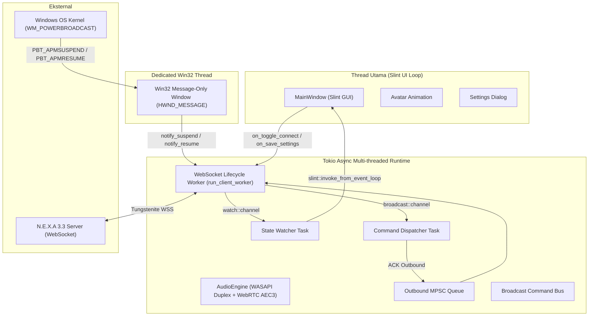

# Arsitektur Sistem — N.E.X.A Windows Bridge

Dokumen ini menjelaskan rancangan arsitektur, model konkurensi, aliran data (*data flow*), serta integrasi hardware pada aplikasi `nexa-windows-bridge`.

---

## 1. Diagram Arsitektur Tingkat Tinggi

---

## 2. Model Konkurensi & Manajemen Thread

Aplikasi ini menggunakan pemisahan tanggung jawab yang ketat antar thread untuk memastikan antarmuka tetap responsif (60 FPS tanpa jeda/stutter) dan tidak terblokir oleh I/O jaringan atau sinyal OS:

### A. Main Thread (Slint GUI Event Loop)
* Menjalankan fungsi `main_window.run()?` yang menangani render UI, interpolasi animasi avatar, dan event mouse/keyboard.
* Komunikasi dari background task ke Slint UI **harus** melalui `slint::invoke_from_event_loop(...)` menggunakan pointer lemah (`Weak<MainWindow>`) untuk mencegah *data race* atau *memory leak*.

### B. Tokio Multi-Threaded Asynchronous Runtime
* Diinisialisasi melalui macro `#[tokio::main]`.
* Mengelola tugas-tugas non-blocking:
  1. **WebSocket Lifecycle Worker (`run_client_worker`)**: Loop koneksi persisten yang menangani *handshake*, antrean pengiriman pesan, pembacaan paket, dan *exponential backoff*.
  2. **State Watcher**: Memantau perubahan `ConnectionState` dan menyinkronkan status visual ke jendela utama.
  3. **Command Dispatcher**: Mendistribusikan instruksi dari server ke modul handler lokal dan mengirimkan *ACK (CommandResult)* kembali ke server.
  4. **Connection Tester Task**: Task temporer untuk memverifikasi handshake WebSocket saat pengguna menekan tombol *"Test Connection"* di panel pengaturan.

### C. Dedicated Win32 OS Thread (`PowerListener`)
* Windows `WM_POWERBROADCAST` memerlukan *message loop* standar Win32 (`GetMessageW` & `DispatchMessageW`).
* Thread terpisah di-*spawn* menggunakan `std::thread::spawn` yang mendaftarkan *window class* (`WNDCLASSW`) tersembunyi yang terpasang pada `HWND_MESSAGE`.
* Menghindari interferensi dengan event loop Slint atau Tokio runtime.

---

## 3. Jalur Komunikasi Antar Komponen (Internal Channels)

| Channel | Tipe | Arah | Fungsi |
| :--- | :--- | :--- | :--- |
| `state_tx` | `tokio::sync::watch` | Worker $\to$ UI Watcher | Mengabarkan status koneksi terbaru (`Connected`, `Connecting`, `Reconnecting`, `Disconnected`, `Suspended`). |
| `outbound_tx` | `tokio::sync::mpsc (128)` | UI/Main $\to$ Worker | Antrean pesan keluar (JSON string atau paket biner audio). |
| `command_tx` | `tokio::sync::broadcast (64)` | Worker $\to$ Handlers | Bus multi-subscriber untuk pesan `EXECUTE_COMMAND` dari server. |
| `reconnect_notify` | `tokio::sync::Notify` | UI/Power $\to$ Worker | Memicu percobaan koneksi instan (mengabaikan timer backoff). |
| `session_interrupt` | `tokio::sync::Notify` | UI/Power $\to$ Worker | Memutus loop sesi aktif secara instan saat user memilih disconnect atau laptop sleep. |

---

## 4. Penanganan Siklus Daya Laptop (Power State Management)

Dirancang khusus untuk laptop **Lenovo ThinkPad X380 Yoga** yang sering dibuka-tutup engselnya (*laptop/tablet mode transition*):

1. **Lid Close / Sleep (`PBT_APMSUSPEND`)**:
   - `PowerListener` menerima sinyal OS.
   - Memanggil `network_client.notify_suspend()`.
   - Bendera `is_suspended` diubah menjadi `true`.
   - `session_interrupt` dipicu; socket ditutup rapi (*graceful Close frame*).
   - UI status berubah menjadi: `"Laptop Sleeping (Suspended)"`, avatar masuk ke mode `offline`.
   - Worker menunda percobaan reconnect sampai laptop terbangun (mencegah pemborosan baterai saat laptop sleep).

2. **Lid Open / Wake (`PBT_APMRESUMEAUTOMATIC` / `PBT_APMRESUMESUSPEND`)**:
   - `PowerListener` menerima sinyal bangun.
   - Memanggil `network_client.notify_resume()`.
   - Bendera `is_suspended` diset kembali ke `false`.
   - `reconnect_notify` langsung ditembakkan.
   - Worker secara instan melakukan *handshake* ulang tanpa harus menunggu timer backoff.

---

## 5. Efisiensi Memori (Ultra-Low RAM Mode)

* **Target Memori:** Alokasi RAM dijaga di bawah **25 MB**.
* **Strategi Efisiensi:**
  * Slint tidak menggunakan browser engine (seperti Electron/Tauri Webview), melainkan renderer native direct software / Skia / Qt yang sangat irit RAM.
  * Buffer channel dibatasi ketat: MPSC 128 items, broadcast 64 items.
  * *Stale frames* otomatis dibuang (*drain*) setiap kali sesi baru terhubung.
