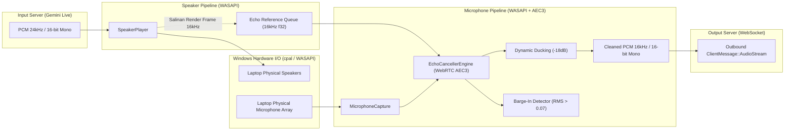

# Spesifikasi Subsistem Audio — N.E.X.A Windows Bridge

Dokumen ini menjelaskan rancangan teknis subsistem audio dua arah (*duplex*), algoritma peredam gema (*Acoustic Echo Cancellation / AEC3*), mitigasi latensi, serta deteksi interupsi pengguna (*barge-in*).

---

## 1. Arsitektur Pemrosesan Audio Duplex

Subsistem audio dirancang untuk pengoperasian tanpa headset (*headset-free*) pada laptop **Lenovo ThinkPad X380 Yoga**, di mana mikrofon bawaan terletak dekat dengan speaker fisik laptop.

---

## 2. Komponen Subsistem Audio

### A. `AudioEngine` (`src/audio/mod.rs`)
* Bertindak sebagai *facade* orkestrator yang mengontrol siklus hidup `SpeakerPlayer` dan `MicrophoneCapture`.
* Menghubungkan channel internal antara speaker render reference dan input mikrofon.
* Mengelola status percakapan AI (`is_speaking`) dan mendistribusikan notifikasi `barge_in_notify` ke runtime utama.

### B. `EchoCancellerEngine` (`src/audio/echo_canceller.rs`)
* **Core Engine:** WebRTC AEC3 (*Acoustic Echo Canceller 3*), *Noise Suppression*, dan *Gain Controller 2* via binding `sonora`.
* **Karakteristik Operasi:**
  * Sample rate pemrosesan internal: **16.000 Hz (16 kHz mono)**.
  * Ukuran frame kalkulasi: **160 sampel (10 ms)**.
  * Buffer render queue: ~200 ms (`VecDeque<f32>` kapasitas 3200 float) untuk mengantisipasi jeda hardware antara clock speaker dan mikrofon.
* **Fitur Tambahan:**
  * **Dynamic Ducking:** Reduksi gain audio mikrofon sebesar `-18 dB` (`factor = 0.125`) saat AI sedang berbicara untuk mencegah feedback loop.
  * **Barge-In Detector:** Mengukur level energi RMS (Root Mean Square) pada frame yang sudah difilter. Jika nilai RMS melampaui `barge_in_threshold (0.07)`, sistem mendeteksi bahwa pengguna sedang menyela AI dan memicu interupsi audio seketika.

### C. `SpeakerPlayer` (`src/audio/speaker.rs`)
* Menginisialisasi output stream WASAPI default menggunakan `cpal`.
* Menerima audio respons berformat **24 kHz 16-bit mono**.
* Mengonversi sampel integer `i16` ke float `f32`, melakukan *downsampling* ke 16 kHz untuk disalurkan ke antrean referensi AEC, serta memasukkan audio ke ring buffer speaker.

### D. `MicrophoneCapture` (`src/audio/microphone.rs`)
* Membuka input stream mikrofon WASAPI default.
* Mengumpulkan sampel audio mentah, menyinkronkannya dengan frame referensi speaker, dan memasukkannya ke mesin AEC3 per blok 10 ms.
* Hasil audio bersih dienkode kembali menjadi byte PCM 16-bit mono dan dikirim ke channel pengiriman WebSocket.

### E. `AudioRingBuffer` (`src/audio/audio_buffer.rs`)
* Struktur data *Single-Producer Single-Consumer (SPSC)* berbasis `ringbuf`.
* **Lock-free & Zero-Allocation:** Thread audio realtime dengan prioritas tinggi tidak pernah terblokir oleh *mutex contention* atau alokasi heap saat membaca/menulis sampel audio.

### F. `Resampler` (`src/audio/resampler.rs`)
* Menggunakan algoritma interpolasi polinomial linear/hermite berlatensi rendah untuk konversi laju sampel (misal 24 kHz ke 16 kHz, atau 48 kHz ke 16 kHz) tanpa menambah beban CPU yang signifikan.
