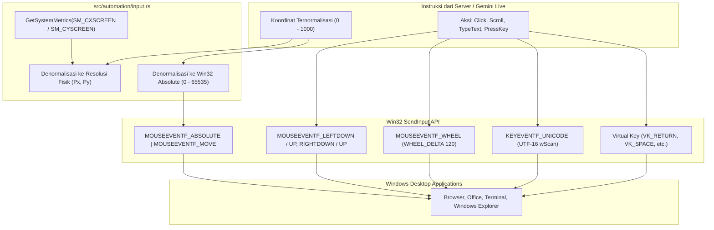

# Spesifikasi Subsistem Otomasi Input & Panduan Layar — N.E.X.A Windows Bridge

Dokumen ini mendokumentasikan arsitektur teknis modul otomasi desktop ([`src/automation/`](../src/automation)), meliputi simulasi input fisik (*SendInput* mouse & keyboard), denormalisasi koordinat, integrasi *Windows UI Automation*, dan sistem jendela overlay siluman (*Stealth Windowing*).

---

## 1. Arsitektur Otomasi Input Desktop (Milestone 6.1)

Modul [`src/automation/input.rs`](../src/automation/input.rs) bertanggung jawab melakukan injeksi event mouse dan keyboard tingkat rendah menggunakan Win32 API `SendInput`.

---

## 2. Fitur & Komponen Utama

### A. Denormalisasi Koordinat Bebas Masalah Display Scaling
* Model AI Gemini Live bekerja dengan sistem koordinat ternormalisasi `x: [0..1000]`, `y: [0..1000]`.
* Fungsi `denormalize_to_pixels()` menghitung posisi piksel fisik pada layar monitor dengan memperhitungkan resolusi asli ThinkPad X380 Yoga.
* Fungsi `denormalize_to_mouse_absolute()` mengonversi koordinat secara langsung ke rentang koordinat absolut Windows `0..65535` untuk bendera `MOUSEEVENTF_ABSOLUTE`.

### B. Otomasi Mouse (`desktop_click` & `desktop_scroll`)
* **Klik Tombol Mouse:** Mendukung tombol kiri (`LEFT`), kanan (`RIGHT`), dan tengah (`MIDDLE`).
* **Klik Ganda (*Double-Click*):** Menjalankan siklus klik pertama, jeda mikro 70 ms, lalu siklus klik kedua.
* **Pengguliran Layar (*Scroll*):** Menggunakan `MOUSEEVENTF_WHEEL` dengan kalkulasi kelipatan `WHEEL_DELTA` (120 unit per notch) untuk arah `"UP"` dan `"DOWN"`.

### C. Otomasi Keyboard Bebas Layout (`desktop_type_text` & `desktop_press_key`)
* **Pengetikan Teks Unicode:** Menggunakan bendera `KEYEVENTF_UNICODE` dengan nilai `wScan` berisi kode unit UTF-16. Hal ini menjamin pengetikan teks bahasa Indonesia, simbol khusus, maupun aksara non-Latin dapat dilakukan dengan presisi 100% tanpa bergantung pada layout keyboard aktif di Windows.
* **Penekanan Tombol Virtual:** Mendukung tombol-tombol fungsional seperti `"ENTER"`, `"SPACE"`, `"ESCAPE"`, `"TAB"`, `"BACKSPACE"`, `"UP"`, `"DOWN"`, `"LEFT"`, `"RIGHT"`, tombol fungsi `"F1"` - `"F12"`, serta karakter alfanumerik tunggal.

### D. Magnetic Smart-Snap via Windows UI Automation (Milestone 6.2)
* Modul [`src/automation/element_finder.rs`](../src/automation/element_finder.rs) mengintegrasikan COM API resmi Microsoft Windows (`IUIAutomation::ElementFromPoint`).
* **Koreksi Presisi Sub-Piksel:** Koordinat target yang dikirim Gemini Live (yang rentan meleset beberapa piksel akibat kompresi visual JPEG) otomatis ditarik secara magnetis (*magnetic snap*) ke batas fisik kontrol OS (`CurrentBoundingRectangle`).
* **Filtering & Rasionalitas:** Mengeliminasi elemen yang terlalu kecil (<4px) atau terlalu besar (>95% layar seperti desktop root).
* **AI Vision Fallback:** Jika elemen berada pada kanvas tak berstruktur (diagram/game), sistem otomatis *fallback* memakai *Vision Bounding Box* dari Gemini Live tanpa error (`is_snapped: false`).

### E. Stealth Overlay Window & Click Ripple Indicator (Milestone 6.3)
* Window transparan berbasis Slint + Win32 API (`ui/overlay_window.slint` & `src/automation/highlighter.rs`).
* **Stealth Windowing Architecture:**
  - `WS_EX_TRANSPARENT`: 100% tembus klik mouse (*click-through*), pengguna dapat mengeklik tombol target tanpa terhalang overlay.
  - `WS_EX_TOPMOST`: Selalu di lapisan visual teratas di atas jendela aplikasi mana pun.
  - `WS_EX_NOACTIVATE`: Tidak pernah mencuri fokus keyboard atau kursor aktif pengguna.
  - `WS_EX_LAYERED`: Rendering transparansi GPU yang bersih.
* **4 Variasi Gaya Sorotan Visual:**
  - `BOX`: Bounding box bercahaya cyan dengan label mengambang dan corner ticks futuristik.
  - `RING`: Cincin konsentris berdenyut melingkari target.
  - `POINTER`: Reticle dan titik penunjuk kursor.
  - `SPOTLIGHT`: Efek peredupan layar di sekitar elemen untuk memfokuskan pandangan.
* **Click Ripple Indicator (300ms):**
  - Riak lingkaran cyan ekspansif (12px $\to$ 45px) dengan pemudaran halus (0.85 $\to$ 0.0) di koordinat klik setiap kali `desktopClick` dieksekusi.
* **Siklus Hidup & Auto-Dissolve:**
  - Timer pembubaran otomatis berbasis *epoch atomic token* untuk mencegah konflik antar-sorotan berturut-turut.
  - Fungsi pembersihan manual `clear_all()` untuk aksi `CLEAR_HIGHLIGHTS`.

### F. Command Dispatcher & WebSocket Integration (Milestone 6.4)
* Mengorkestrasi seluruh subsistem otomasi melalui fungsi utama [`handle_execute_command`](../src/automation/mod.rs).
* **Penanganan 7 Perintah Desktop Standar Live Tool Registry:**
  1. `DESKTOP_CLICK`: Validasi koordinat normalisasi `(x, y)` [0..1000], konversi tombol (`LEFT`, `RIGHT`, `MIDDLE`), klik ganda, picu *click ripple* visual, dan eksekusi klik Win32.
  2. `DESKTOP_SCROLL`: Pengguliran layar berdasarkan `direction` (`UP`/`DOWN`) dan jumlah notch `amount` via `MOUSEEVENTF_WHEEL`.
  3. `DESKTOP_TYPE_TEXT`: Pengetikan teks Unicode bebas tata letak, pemetaan otomatis baris baru `\n` ke `VK_RETURN`, dan opsi penekanan Enter di akhir teks.
  4. `DESKTOP_PRESS_KEY`: Penekanan tombol virtual keyboard fungsional dan navigasi.
  5. `HIGHLIGHT_ELEMENT`: Evaluasi koordinat bounding box, *magnetic smart-snap* ke elemen OS via Windows UI Automation, dan perenderan overlay visual sesuai gaya (`BOX`, `RING`, `POINTER`, `SPOTLIGHT`).
  6. `POINT_CURSOR`: Penunjukan titik kursor pada koordinat tertentu.
  7. `CLEAR_HIGHLIGHTS`: Pembersihan seketika seluruh overlay dan sorotan aktif.
* **Integrasi Non-Blocking Async (`src/main.rs`):**
  - Menerima `ServerMessage::ExecuteCommand` melalui channel tokio mpsc.
  - Mengeksekusi penanganan otomasi di background task (`tokio::spawn`) agar tidak memblokir alur data audio dupleks WASAPI maupun loop jaringan utama.
  - Mengirimkan balik hasil tipe-kuat `ClientMessage::CommandResult` ke peladen Azure.

---

## 3. Rencana Milestone Subsistem Otomasi (Fase 6)

| Milestone | Deskripsi | Status |
| :--- | :--- | :--- |
| **Milestone 6.1** | Desktop Input Automation (`src/automation/input.rs`) — SendInput mouse & keyboard | **SELESAI ✅** |
| **Milestone 6.2** | Magnetic Smart-Snap via Windows UI Automation (`src/automation/element_finder.rs`) | **SELESAI ✅** |
| **Milestone 6.3** | Stealth Overlay & Click Ripple (`src/automation/highlighter.rs`) | **SELESAI ✅** |
| **Milestone 6.4** | Router EXECUTE_COMMAND & WebSocket Binding di `src/main.rs` | **SELESAI ✅** |
| **Milestone 6.5** | Verifikasi Komprehensif, Audit Zero-Warning Clippy, & Git Push | *Berikutnya* |
