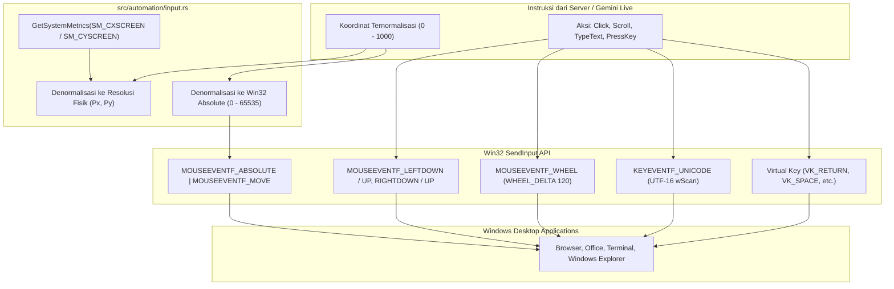

# Spesifikasi Subsistem Otomasi Input & Panduan Layar — N.E.X.A Windows Bridge

Dokumen ini mendokumentasikan arsitektur teknis modul otomasi desktop ([`src/automation/`](../src/automation)), meliputi simulasi input fisik (*SendInput* mouse & keyboard), denormalisasi koordinat, integrasi *Windows UI Automation*, dan sistem jendela overlay siluman (*Stealth Windowing*).

---

## 1. Arsitektur Otomasi Input Desktop (Milestone 6.1)

Modul [`src/automation/input.rs`](../src/automation/input.rs) bertanggung jawab melakukan injeksi event mouse dan keyboard tingkat rendah menggunakan Win32 API `SendInput`.

---

## 2. Fitur & Komponen Utama

### A. Denormalisasi Koordinat Bebas Masalah Display Scaling
* Model AI Gemini Live bekerja dengan sistem koordinat ternormalisasi `x: [0..1000]`, `y: [0..1000]`.
* Fungsi `denormalize_to_pixels()` menghitung posisi piksel fisik pada layar monitor dengan memperhitungkan resolusi asli ThinkPad X380 Yoga.
* Fungsi `denormalize_to_mouse_absolute()` mengonversi koordinat secara langsung ke rentang koordinat absolut Windows `0..65535` untuk bendera `MOUSEEVENTF_ABSOLUTE`.

### B. Otomasi Mouse (`desktop_click` & `desktop_scroll`)
* **Klik Tombol Mouse:** Mendukung tombol kiri (`LEFT`), kanan (`RIGHT`), dan tengah (`MIDDLE`).
* **Klik Ganda (*Double-Click*):** Menjalankan siklus klik pertama, jeda mikro 70 ms, lalu siklus klik kedua.
* **Pengguliran Layar (*Scroll*):** Menggunakan `MOUSEEVENTF_WHEEL` dengan kalkulasi kelipatan `WHEEL_DELTA` (120 unit per notch) untuk arah `"UP"` dan `"DOWN"`.

### C. Otomasi Keyboard Bebas Layout (`desktop_type_text` & `desktop_press_key`)
* **Pengetikan Teks Unicode:** Menggunakan bendera `KEYEVENTF_UNICODE` dengan nilai `wScan` berisi kode unit UTF-16. Hal ini menjamin pengetikan teks bahasa Indonesia, simbol khusus, maupun aksara non-Latin dapat dilakukan dengan presisi 100% tanpa bergantung pada layout keyboard aktif di Windows.
* **Penekanan Tombol Virtual:** Mendukung tombol-tombol fungsional seperti `"ENTER"`, `"SPACE"`, `"ESCAPE"`, `"TAB"`, `"BACKSPACE"`, `"UP"`, `"DOWN"`, `"LEFT"`, `"RIGHT"`, tombol fungsi `"F1"` - `"F12"`, serta karakter alfanumerik tunggal.

### D. Magnetic Smart-Snap via Windows UI Automation & Timeout Guard (Audit H8)
* Modul [`src/automation/element_finder.rs`](../src/automation/element_finder.rs) mengintegrasikan COM API resmi Microsoft Windows (`IUIAutomation::ElementFromPoint`).
* **Koreksi Presisi Sub-Piksel:** Koordinat target yang dikirim Gemini Live (yang rentan meleset beberapa piksel akibat kompresi visual JPEG) otomatis ditarik secara magnetis (*magnetic snap*) ke batas fisik kontrol OS (`CurrentBoundingRectangle`).
* **Timeout Guard 150ms (`smart_snap_bounding_box_timeout`):** Query COM UI Automation bersifat lintas-proses (*inter-process communication*). Jika aplikasi pihak ketiga target sedang hang (*not responding*), query COM standar dapat memblokir thread hingga timeout RPC OS beberapa detik. Dengan `smart_snap_bounding_box_timeout`, thread pemanggil dibatasi maksimal 150 ms; jika terlampaui, sistem otomatis *fallback* instan ke koordinat AI tanpa mem-freeze dispatcher maupun UI.
* **Filtering & Rasionalitas:** Mengeliminasi elemen yang terlalu kecil (<4px) atau terlalu besar (>95% layar seperti desktop root).
* **AI Vision Fallback:** Jika elemen berada pada kanvas tak berstruktur (diagram/game), sistem otomatis *fallback* memakai *Vision Bounding Box* dari Gemini Live tanpa error (`is_snapped: false`).

### E. Stealth Overlay Window & Click Ripple Indicator (Milestone 6.3)
* Window transparan berbasis Slint + Win32 API (`ui/overlay_window.slint` & `src/automation/highlighter.rs`).
* **Stealth Windowing Architecture:**
  - `WS_EX_TRANSPARENT`: 100% tembus klik mouse (*click-through*), pengguna dapat mengeklik tombol target tanpa terhalang overlay.
  - `WS_EX_TOPMOST`: Selalu di lapisan visual teratas di atas jendela aplikasi mana pun.
  - `WS_EX_NOACTIVATE`: Tidak pernah mencuri fokus keyboard atau kursor aktif pengguna.
  - `WS_EX_TOOLWINDOW` (Audit M5): Mencegah overlay muncul di daftar *Alt-Tab application switcher* atau taskbar Windows.
  - `DwmExtendFrameIntoClientArea` dengan margin `(-1, -1, -1, -1)`: Menjamin transparansi GPU hardware glass murni tanpa glitch kanvas hitam.
* **Normalisasi Skala DPI ThinkPad X380 Yoga (Audit M6):**
  - Layar ThinkPad X380 Yoga memiliki resolusi 1080p dengan skala default Windows 150% (`scale_factor = 1.5`).
  - Slint menggunakan koordinat logis, sedangkan input Win32 menggunakan piksel fisik monitor. Modul `highlighter` secara otomatis membagi dimensi fisik dengan `w.window().scale_factor()` (`target_x / scale`, `target_w / scale`, dll.) sehingga bounding box dan ripple indicator jatuh tepat di atas tombol target tanpa pergeseran 1.5x.
* **Proteksi Runtime Tokio Asinkron (Audit M7):**
  - Pemanggilan fungsi asinkron (seperti timer pembubaran otomatis dan animasi riak) diproteksi menggunakan `Handle::try_current()` agar aman dipanggil baik dari thread UI, event loop Slint, maupun worker Tokio tanpa risiko panic "no reactor running".
* **Pembersihan Layar Hitam Startup:**
  - Jendela overlay diinisialisasi dalam keadaan tersembunyi (`w.hide()`) saat aplikasi dibuka, dan hanya dipanggil `w.show()` saat ada aksi sorotan aktif. Setelah timer auto-dissolve selesai, jendela kembali disembunyikan (`w.hide()`) agar tidak pernah memblokir layar pengguna.
* **4 Variasi Gaya Sorotan Visual:**
  - `BOX`: Bounding box bercahaya cyan dengan label mengambang dan corner ticks futuristik.
  - `RING`: Cincin konsentris berdenyut melingkari target.
  - `POINTER`: Reticle dan titik penunjuk kursor.
  - `SPOTLIGHT`: Efek peredupan layar di sekitar elemen untuk memfokuskan pandangan.
* **Click Ripple Indicator (300ms):**
  - Riak lingkaran cyan ekspansif (12px $\to$ 45px) dengan pemudaran halus (0.85 $\to$ 0.0) di koordinat klik setiap kali `desktopClick` dieksekusi.
* **Siklus Hidup & Auto-Dissolve:**
  - Timer pembubaran otomatis berbasis *epoch atomic token* untuk mencegah konflik antar-sorotan berturut-turut.
  - Fungsi pembersihan manual `clear_all()` untuk aksi `CLEAR_HIGHLIGHTS`.

### F. Command Dispatcher & Antrean Serial FIFO Ber-Epoch (Milestone 6.4 & 7.1)
* Mengorkestrasi seluruh subsistem otomasi melalui fungsi utama [`handle_execute_command`](../src/automation/mod.rs).
* **Antrean Serial FIFO dengan Isolasi Panic (Audit H10, K2, K9):**
  - Perintah masuk disalurkan ke antrean non-blocking `mpsc::channel(32)` yang diproses secara berurutan (*serial execution*) agar klik dan pengetikan tidak tumpang-tindih.
  - Setiap perintah diikat dengan nomor generasi sesi (`session_generation`). Jika sesi di-reset atau koneksi terputus, perintah basi dibatalkan instan (*stale command dropped*).
  - Setiap eksekusi dibungkus dalam `tokio::spawn` terisolasi sehingga panic tak terduga tidak membunuh loop worker.

### G. Perintah Ekstensi Desktop & Kontrol Sistem OS (Milestone 6.6)
Selain 7 perintah interaksi dasar, subsistem otomasi mendukung perintah sistem terverifikasi:
1. `LAUNCH_APP`: Membuka aplikasi resmi (Chrome, Notepad, Calculator, Explorer, VS Code, Edge) atau tautan URL `http(s)://` yang telah disanitasi dari karakter injeksi shell (`&`, `|`, `;`, dll.) menggunakan Win32 `ShellExecuteW`. Menolak keras eksekusi `.exe` bebas, skrip `.bat/.cmd/.ps1`, maupun jalur UNC.
2. `LOCK_SCREEN`: Mengunci workstation Windows seketika melalui native Win32 API `LockWorkStation` (`windows_sys::Win32::System::Shutdown`).
3. `SHOW_DESKTOP`: Menampilkan desktop Windows seketika menggunakan kombinasi native Win32 `SendInput` tombol `Win + D`, bebas dari *console flashing* tanpa memanggil PowerShell eksternal.
4. `SET_VOLUME`: Menyesuaikan volume suara laptop secara proporsional berdasarkan `volume_level` (0.0 - 1.0) atau jumlah langkah (`steps` / `amount` dibatasi 1 - 25 langkah) dengan penekanan tombol `VOLUME_UP` / `VOLUME_DOWN`.
5. `MUTE`, `UNMUTE`, `TOGGLEMUTE`: Mengendalikan mute speaker laptop. `UNMUTE` dipisahkan secara aman dari tombol toggle dengan mengirimkan penekanan tombol `VOLUME_UP` (standar OS Windows untuk memulihkan audio tanpa risiko membisukan kembali).
6. `TAKE_SCREENSHOT`: Menangkap tangkapan layar perangkat.
7. `GET_BATTERY_STATUS`: Membaca telemetri daya real-time melalui Win32 `GetSystemPowerStatus` (level baterai %, status pengisian AC/DC).
8. `GET_SYSTEM_METRICS`: Membaca metrik perangkat keras sistem (CPU, RAM, dimensi layar fisik).
9. `ABORT_AUTOMATION`: Pembatalan otomasi jalur cepat (*fast-path*) yang melompati antrean FIFO, menaikkan epoch generasi sesi, meminta pembatalan atomik, dan menghapus seluruh sorotan layar seketika.

### H. Arsitektur Keamanan Armed Guard & Proteksi Terminal (Audit N2, R2, R3)
* **Default-Deny:** Semua otomasi yang melakukan interaksi fisik (`CLICK`, `SCROLL`, `TYPE_TEXT`, `PRESS_KEY`), meluncurkan aplikasi, atau mengubah sistem wajib memperoleh izin (**Armed**).
* **Lease 15 Menit:** Pengaktifan status armed via System Tray otomatis kedaluwarsa setelah 15 menit menggunakan epoch Unix timestamp, mencegah izin aktif selamanya tanpa pengawasan.
* **Normalisasi Kanonikal (`canonical_action`):** Seluruh aksi diverifikasi konsisten terlepas dari gaya penamaan (`camelCase`, `kebab-case`, `snake_case`, atau spasi).
* **Proteksi Terminal Konsol Latar Depan:** Memeriksa jendela aktif sebelum mengetik; otomatis memblokir `DESKTOP_TYPE_TEXT` dan `DESKTOP_PRESS_KEY` jika jendela aktif adalah `cmd.exe`, `powershell.exe`, `pwsh.exe`, `WindowsTerminal.exe`, `conhost.exe`, atau `regedit.exe`.
* Untuk dokumentasi keamanan lengkap, lihat [Spesifikasi Keamanan & Kebijakan Otomasi](SECURITY.md).

---

## 3. Status Rencana Milestone Subsistem Otomasi

| Milestone | Deskripsi | Status |
| :--- | :--- | :--- |
| **Milestone 6.1** | Desktop Input Automation (`src/automation/input.rs`) — SendInput mouse & keyboard | **SELESAI ✅** |
| **Milestone 6.2** | Magnetic Smart-Snap via Windows UI Automation & Timeout Guard 150ms | **SELESAI ✅** |
| **Milestone 6.3** | Stealth Overlay, Click Ripple, & High-DPI Scaling 150% ThinkPad Yoga | **SELESAI ✅** |
| **Milestone 6.4** | Router EXECUTE_COMMAND & WebSocket Binding di `src/main.rs` | **SELESAI ✅** |
| **Milestone 6.5** | Verifikasi Komprehensif & Audit Review (C1, H1-H8, M1-M8) | **SELESAI ✅** |
| **Milestone 6.6** | Ekstensi Aksi Desktop: Safe App Launch, Lock Screen, Show Desktop, Honest Volume | **SELESAI ✅** |
| **Milestone 7.1** | Antrean Serial FIFO Ber-Epoch, Isolasi Panic, dan Fast-Path Abort | **SELESAI ✅** |
| **Milestone 7.2** | Audit Keamanan Ronde 1 (N1-N11): Eliminasi Injeksi cmd, Armed Guard Tray, Graceful Drop | **SELESAI ✅** |
| **Milestone 7.3** | Audit Keamanan Ronde 2 (R1-R9): Strict TLS Loopback, Terminal Guard, 15-Min Lease | **SELESAI ✅** |
