# Spesifikasi Subsistem Screen Capture & Vision — N.E.X.A Windows Bridge

Dokumen ini mendokumentasikan arsitektur teknis penangkapan layar (*GPU Screen Capture*), kompresi JPEG, pembatasan *frame rate*, serta transmisi visual ke Server AI N.E.X.A (khususnya untuk *Gemini Live Vision*).

---

## 1. Arsitektur Pipeline Pengambilan Layar GPU

Subsistem ini diimplementasikan di dalam modul [`src/capture/`](../src/capture) menggunakan Windows Graphics Capture API (WGC) modern berbasis **Direct3D 11**.

```mermaid
graph LR
    subgraph Windows_OS_GPU ["Windows GPU Subsystem"]
        Display["Primary Display Monitor"]
        D3D11["Direct3D 11 Texture Buffer (RGBA)"]
        Display -->|Hardware Composition| D3D11
    end

    subgraph Capture_Engine ["src/capture/screen_capture.rs"]
        WGC["Windows Graphics Capture API Handler"]
        Limiter["FrameRateLimiter (e.g. 1 FPS)"]
        Encoder["FrameEncoder (TurboJPEG / Image)"]
        D3D11 --> WGC
        WGC --> Limiter
        Limiter -->|Pass Allowed Frame| Encoder
    end

    subgraph Network_Transmission ["src/network/client.rs"]
        B64["Base64 JPEG String"]
        Msg["ClientMessage::VideoFrame"]
        WS["WebSocket Stream"]
        Encoder --> B64
        B64 --> Msg
        Msg --> WS
    end
```

---

## 2. Komponen Utama Subsistem

### A. `ScreenCaptureController` (`src/capture/screen_capture.rs`)
* Mengontrol thread penangkap layar latar belakang.
* Menginisialisasi `windows_capture::monitor::Monitor::primary()` untuk menangkap tampilan monitor utama ThinkPad (1920x1080).
* Mengkonfigurasi parameter WGC:
  * `ColorFormat::Rgba8`: Format warna 32-bit standar.
  * `CursorCaptureSettings::WithCursor`: Mengikutsertakan kursor mouse agar AI dapat melihat ke mana pengguna menunjuk.
  * `DrawBorderSettings::WithoutBorder`: Menghilangkan garis tepi kuning (*yellow capture border*) khas Windows Screen Capture agar tampilan tetap bersih.

### B. `FrameRateLimiter` (`src/capture/encoder.rs`)
* Fitur *Vision AI* (seperti Gemini Live) tidak memerlukan 60 FPS yang memboroskan bandwidth dan komputasi GPU, melainkan cukup **1 FPS hingga 2 FPS**.
* Menggunakan timer resolusi tinggi (`std::time::Instant`).
* Mencegah pemborosan alokasi memori CPU dan enkoder JPEG dengan mengabaikan (*drop*) frame sebelum masuk ke tahap kompresi jika interval minimum belum tercapai.

### C. `FrameEncoder` (`src/capture/encoder.rs`)
* Mengonversi buffer RGBA mentah dari GPU menjadi format terkompresi **JPEG**.
* **Kualitas Kompresi:** Default kualitas 75% (menjaga keseimbangan antara keterbacaan teks di layar dan ukuran payload jaringan kecil).
* **Base64 Encoding:** Mengenkode hasil kompresi byte JPEG menjadi string teks Base64 untuk dikemas ke dalam paket JSON WebSocket.

---

## 3. Efisiensi Hardware pada Intel UHD Graphics 620

Dirancang khusus untuk chip grafis terintegrasi (*integrated GPU*) pada **Lenovo ThinkPad X380 Yoga**:
* **Zero Desktop Duplication Legacy:** Menghindari penggunaan GDI `BitBlt` atau DXGI 1.1 Duplication API lama yang sering menyebabkan stutter CPU.
* **Direct Hardware Buffer Access:** Membaca langsung dari permukaan Direct3D 11 tanpa memblokir thread rendering Slint GUI.
* **Memory Guard:** Frame buffer lama langsung di-drop jika koneksi WebSocket mengalami latensi tinggi (*backpressure protection*).
