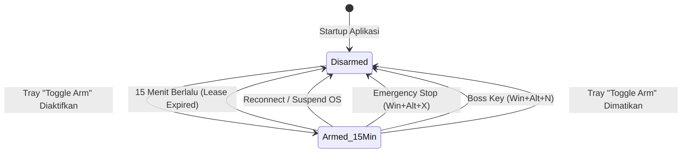
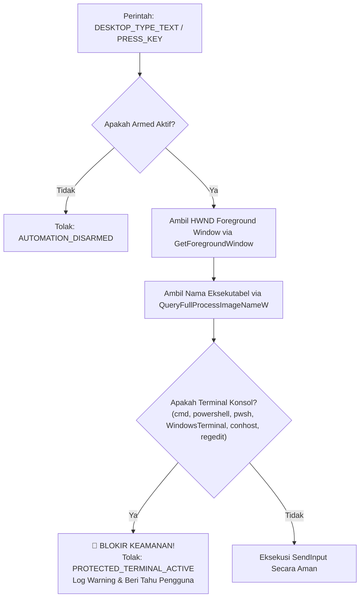

# Arsitektur Keamanan & Kebijakan Otomasi — N.E.X.A Windows Bridge

Dokumen ini mendokumentasikan secara menyeluruh model keamanan, kebijakan izin otomasi, proteksi injeksi, enkripsi transport, dan mekanisme tombol darurat pada **Nexa Bridge** (`nexa-windows-bridge`).

Arsitektur keamanan ini telah melewati audit keamanan multi-ronde (Sertifikasi Remediasi N1–N11 dan R1–R9) untuk memastikan perangkat Lenovo ThinkPad X380 Yoga terlindungi dari *remote code execution* (RCE), *prompt injection*, manipulasi terminal tanpa izin, maupun intersepsi jaringan.

---

## 1. Filosofi & Model Ancaman (Threat Model)

Nexa Bridge beroperasi pada tingkat hak istimewa pengguna (*standard user privilege*) dengan akses ke API input Windows tingkat rendah (`SendInput`, `IUIAutomation`, `ShellExecuteW`). Karena aplikasi menerima perintah kendali desktop dari server AI jarak jauh, diterapkan prinsip-prinsip berikut:

1. **Default-Deny (Ketat Sejak Awal):** Otomasi desktop yang memengaruhi sistem secara fisik selalu dimulai dalam keadaan nonaktif (**DISARMED**) saat aplikasi pertama kali dijalankan.
2. **Lease Berbatas Waktu (Time-Bounded Lease):** Izin otomasi yang diberikan pengguna bersifat sementara (15 menit) dan otomatis kedaluwarsa, mencegah celah lupa menonaktifkan.
3. **Pemisahan Perintah Aman vs Berbahaya:** Aksi visual (panduan AR/sorotan) dan pemantauan status (baterai, telemetri) selalu diizinkan tanpa memerlukan mode armed, sedangkan aksi fisik (klik, ketik, scroll, peluncuran aplikasi) diblokir jika tidak diizinkan secara eksplisit.
4. **Isolasi Konsol Terminal:** Pengetikan teks otomatis (`DESKTOP_TYPE_TEXT`) dan penekanan tombol (`DESKTOP_PRESS_KEY`) diblokir secara fisik jika jendela konsol/terminal sedang aktif di latar depan, mencegah AI mengeksekusi skrip terminal berbahaya.
5. **Anti-Injeksi Shell:** Panggilan `cmd.exe` dan `powershell.exe` dilarang total dalam subsistem peluncur aplikasi; seluruh eksekusi menggunakan daftar putih absolut dan fungsi API native Windows `ShellExecuteW`.
6. **Transportasi Terenkripsi Wajib (Strict TLS Enforcement):** Lalu lintas jaringan di luar mesin lokal (`localhost`) wajib menggunakan WebSocket terenkripsi (`wss://`).

---

## 2. Kebijakan Izin Otomasi & Armed Guard (Audit N2, R2, R3)

### A. Siklus Hidup "Armed Lease" (15 Menit)
Status armed disimpan secara thread-safe menggunakan `Arc<AtomicU64>` yang menyimpan stempel waktu Unix (*epoch seconds*) saat izin berakhir:

$$\text{is\_armed} = (\text{now}() < \text{armed\_until})$$

* **Startup:** `armed_until = 0` (DISARMED).
* **Aktivasi via System Tray:** Pengguna memilih menu *"🛡️ Toggle Arm/Disarm Automation"*. Nilai `armed_until` diatur ke $\text{now}() + 900$ detik (15 menit). Notifikasi visual ditampilkan di HUD.
* **Kedaluwarsa Otomatis:** Setelah 15 menit, evaluasi otomatis mengembalikan status ke `DISARMED` tanpa memerlukan intervensi pengguna.
* **Pemutusan Paksa Instan:** Status di-reset seketika ke `0` saat:
  * Koneksi WebSocket terputus atau suspend (`PBT_APMSUSPEND`).
  * Tombol Darurat ditekan (**Win + Alt + X**).
  * Boss Key ditekan (**Win + Alt + N**).
  * Pengguna menonaktifkannya kembali secara manual melalui System Tray.



---

## 3. Normalisasi Aksi & Klasifikasi Izin (Audit R2)

Server atau model AI dapat mengirimkan nama perintah dalam berbagai format penulisan (misal `highlightElement`, `HIGHLIGHT_ELEMENT`, `abort-automation`, atau `desktopClick`). Fungsi kanonikal `canonical_action(&str)` menormalisasi string:

```rust
pub fn canonical_action(action: &str) -> String {
    action
        .trim()
        .to_uppercase()
        .chars()
        .filter(|c| !matches!(c, '_' | '-' | ' '))
        .collect()
}
```

### Tabel Klasifikasi Izin Perintah:

| Aksi Kanonikal | Format Masukan Server yang Didukung | Kategori | Memerlukan Armed? | Penjelasan Teknis |
| :--- | :--- | :--- | :---: | :--- |
| `HIGHLIGHTELEMENT` | `highlightElement`, `HIGHLIGHT_ELEMENT`, `highlight` | Aman (Visual) | **TIDAK** | Menampilkan kotak/cincin penunjuk AR transparan di layar |
| `CLEARHIGHLIGHTS` | `clearHighlights`, `CLEAR_HIGHLIGHTS`, `clearHighlight` | Aman (Visual) | **TIDAK** | Menghapus seluruh sorotan visual overlay |
| `POINTCURSOR` | `pointCursor`, `POINT_CURSOR` | Aman (Visual) | **TIDAK** | Mengarahkan reticle kursor visual tanpa klik |
| `GETBATTERYSTATUS` | `getBatteryStatus`, `GET_BATTERY_STATUS`, `batteryStatus` | Aman (Status) | **TIDAK** | Membaca persentase baterai via `GetSystemPowerStatus` |
| `GETSYSTEMMETRICS` | `getSystemMetrics`, `SYSTEM_METRICS`, `telemetry` | Aman (Status) | **TIDAK** | Membaca utilisasi CPU/RAM via `GetSystemTimes` |
| `ABORTAUTOMATION` | `abortAutomation`, `ABORT_AUTOMATION`, `cancel`, `stop` | Aman (Kontrol) | **TIDAK** | Membatalkan otomasi yang sedang antre/berjalan |
| `DESKTOPCLICK` | `desktopClick`, `DESKTOP_CLICK`, `click` | Berbahaya (Fisik) | **YA** | Mengirim event mouse `SendInput` ke aplikasi aktif |
| `DESKTOPSCROLL` | `desktopScroll`, `DESKTOP_SCROLL`, `scroll` | Berbahaya (Fisik) | **YA** | Mengirim sinyal roda putar `MOUSEEVENTF_WHEEL` |
| `DESKTOPTYPETEXT` | `desktopTypeText`, `DESKTOP_TYPE_TEXT`, `typeText` | Berbahaya (Fisik) | **YA** | Mengetik karakter Unicode ke kontrol aktif |
| `DESKTOPPRESSKEY` | `desktopPressKey`, `DESKTOP_PRESS_KEY`, `pressKey` | Berbahaya (Fisik) | **YA** | Menekan tombol virtual keyboard (Enter, Tab, dll.) |
| `LAUNCHAPP` | `launchApp`, `LAUNCH_APP`, `openApp` | Berbahaya (Sistem) | **YA** | Membuka aplikasi terverifikasi atau URL web |
| `LOCKSCREEN` | `lockScreen`, `LOCK_SCREEN` | Berbahaya (Sistem) | **YA** | Mengunci sesi Windows via `LockWorkStation` |
| `SHOWDESKTOP` | `showDesktop`, `SHOW_DESKTOP` | Berbahaya (Sistem) | **YA** | Meminimalkan semua jendela via Win+D |
| `SETVOLUME` | `setVolume`, `SET_VOLUME`, `mute`, `unmute` | Berbahaya (Sistem) | **YA** | Mengubah volume audio laptop |

---

## 4. Proteksi Injeksi Konsol Terminal Aktif (Audit R3)

Salah satu skenario serangan AI paling berbahaya adalah saat AI di-arm oleh pengguna, lalu melalui *prompt injection* AI diperintahkan mengetik skrip perusak (misalnya `rmdir /s /q C:\`) ke terminal pengguna yang sedang terbuka.

Nexa Bridge mengatasi celah ini dengan menginspeksi proses jendela aktif sebelum mengeksekusi `DESKTOP_TYPE_TEXT` atau `DESKTOP_PRESS_KEY`:



### Daftar Hitam Eksekutabel Konsol yang Dilindungi:
* `cmd.exe` (Command Prompt Windows)
* `powershell.exe` (Windows PowerShell 5.1)
* `pwsh.exe` (PowerShell Core 7+)
* `windowsterminal.exe` (Windows Terminal)
* `conhost.exe` (Console Window Host)
* `regedit.exe` (Registry Editor)

---

## 5. Peluncur Aplikasi Aman & Sanitasi URL (Audit N1, N7)

Fungsi `launch_desktop_app` (`src/automation/mod.rs`) dirancang dengan prinsip *zero shell execution*:

### A. Larangan Total Shell Interpreter
Panggilan `cmd.exe /c start` dan `powershell.exe` telah **dihapus sepenuhnya**. Tidak ada sintaks shell Windows yang dapat dieksekusi secara tersembunyi.

### B. Daftar Putih Aplikasi (*Whitelist*)
Aplikasi yang boleh diluncurkan terbatas pada aplikasi resmi berikut:
* **Google Chrome:** `chrome.exe` (alias: `"chrome"`, `"google chrome"`, `"browser"`)
* **Notepad:** `notepad.exe` (alias: `"notepad"`, `"catatan"`, `"editor"`)
* **Kalkulator:** `calc.exe` (alias: `"calc"`, `"calculator"`, `"kalkulator"`)
* **File Explorer:** `explorer.exe` (alias: `"explorer"`, `"files"`, `"berkas"`, `"folder"`)
* **VS Code:** `code.cmd` / `code.exe` (alias: `"vscode"`, `"code"`)
* **Microsoft Edge:** `msedge.exe` (alias: `"edge"`, `"msedge"`)

Semua ekstensi berbahaya seperti `.bat`, `.cmd`, `.vbs`, `.ps1`, `.msi`, `.hta`, `.js`, `.reg`, dan jalur UNC jaringan (`\\server\share`) ditolak secara instan.

### C. Sanitasi Protokol URL Web
Jika target merupakan tautan web (`http://` atau `https://`):
1. Target diverifikasi tidak mengandung karakter injeksi perintah shell atau pemisah baris:
   ```text
   &  |  ;  <  >  ^  "  '  `  \r  \n  [spasi]
   ```
   *Contoh:* URL `https://example.com&calc.exe` akan **ditolak keras** sebelum mencapai OS.
2. Peluncuran dilakukan melalui fungsi Win32 resmi `ShellExecuteW` dengan parameter argumen `NULL` dan direktori kerja `NULL`:
   ```rust
   ShellExecuteW(
       0 as _,
       "open\0".as_wide().as_ptr(),
       url.as_wide().as_ptr(),
       std::ptr::null(),
       std::ptr::null(),
       SW_SHOWNORMAL,
   );
   ```

---

## 6. Enkripsi Transportasi & Validasi Host TLS (Audit N5, R1)

Semua komunikasi data audio mikrofon, hasil visual capture, dan perintah otomasi dilindungi oleh enkripsi transport WebSocket:

### A. Pengecekan Loopback Ketat (`is_local_host`)
Protokol tanpa enkripsi (`ws://`) **hanya diizinkan** pada alamat loopback lokal mesin itu sendiri:
* `localhost`
* `127.0.0.1`
* `::1` atau `[::1]`

Semua alamat remote (IP publik, domain internet, IP LAN lokal seperti `192.168.x.x`) **wajib menggunakan enkripsi TLS (`wss://`)**.

### B. Pertahanan Terhadap Vektor Host Spoofing:
| Vektor Serangan Host | Hasil Evaluasi Nexa Bridge | Status Proteksi |
| :--- | :--- | :--- |
| `ws://localhost.evil.com/ws` | **DITOLAK** (Subdomain bukan loopback) | Aman ✅ |
| `ws://127.0.0.1.nip.io/ws` | **DITOLAK** (Suffix domain DNS dinamis) | Aman ✅ |
| `ws://127.0.0.1@evil.com/ws` | **DITOLAK** (Spoofing authority userinfo `@`) | Aman ✅ |
| `ws://192.168.1.100:3000/ws` | **DITOLAK** (IP LAN tanpa TLS wajib `wss://`) | Aman ✅ |
| `ws://127.0.0.1:3000/ws` | **DIIZINKAN** (Loopback sah pengembang) | Aman ✅ |
| `wss://server.nexa.ai/ws` | **DIIZINKAN** (Terkoneksi lewat TLS/WSS) | Aman ✅ |

Validasi ini dipanggil pada dua titik pertahanan:
1. Saat konfigurasi dimuat atau disimpan dari antarmuka Settings (`BridgeConfig::validate_ws_url`).
2. Tepat sebelum soket TCP/TLS dibuka pada loop worker jaringan (`NetworkClient::connect`).

---

## 7. Tombol Darurat & Jalur Pintas Pembatalan (Audit N3, N4)

Jika otomasi sedang berjalan dan pengguna melihat perilaku AI yang tidak diinginkan, tersedia dua lapis tombol darurat:

### A. Tombol Darurat Global: **Win + Alt + X** (`EmergencyStop`)
Didaftarkan pada level kernel Windows menggunakan `RegisterHotKey`:
1. Memicu flag atomik `automation::request_automation_abort()`.
2. Menaikkan nomor generasi sesi (`session_generation.fetch_add(1)`) sehingga seluruh perintah yang sedang antre di FIFO otomatis dibuang (*dropped as stale*).
3. Mengembalikan status armed ke `0` (**DISARMED** seketika).
4. Menghapus seluruh sorotan dan overlay transparan di layar.
5. Menghentikan penangkapan layar Direct3D 11 (*screen share off*).
6. Membisukan mikrofon laptop (*mic muted*).

### B. Boss Key: **Win + Alt + N** (`BossKey`)
Berfungsi ganda untuk privasi dan keselamatan. **Tanpa memandang apakah jendela sedang terlihat atau tersembunyi**, Boss Key selalu:
* Menghentikan otomasi yang sedang berlangsung seketika.
* Menggugurkan antrean perintah dan me-reset status armed.
* Menyembunyikan jendela ke System Tray dan mematikan mikrofon/screen share.

### C. Fast-Path Abort dari Sisi Server
Saat server mengirimkan perintah pembatalan (`ABORT_AUTOMATION`, `CANCEL`, `STOP`), dispatcher **tidak memasukkan perintah ini ke antrean serial FIFO**, melainkan mengeksekusinya di jalur pintas (*fast-path*) dalam mikrodetik untuk memutus operasi ketik/klik yang sedang berjalan.

---

## 8. Integritas Data & Sanitasi Log (Audit K5, N5, R7)

1. **Penyensoran Log Disk (`redact_params`):**
   Teks yang diketikkan pengguna atau AI (meliputi kata sandi, formulir teks, atau token) tidak pernah ditulis secara telanjang ke berkas log harian di `%APPDATA%/nexa-bridge/logs/`. Log hanya mencatat panjang karakter teks:
   ```json
   {"text":"<redacted len=14>","press_enter":true}
   ```
2. **Penyimpanan Konfigurasi Atomik:**
   Penyimpanan berkas `~/.nexa-bridge.json` dilakukan dengan menulis ke berkas sementara `~/.nexa-bridge.json.tmp`, melakukan *flush* ke disk, lalu melakukan penamaan ulang atomik (`std::fs::rename`). Ini mencegah berkas konfigurasi menjadi 0 byte saat laptop mati tiba-tiba.
3. **Penyelamatan Berkas Konfigurasi Rusak (`.bak`):**
   Jika berkas JSON konfigurasi rusak atau gagal di-parse saat aplikasi dinyalakan, bridge otomatis menyalin berkas tersebut ke `~/.nexa-bridge.json.bak` sebelum memuat konfigurasi bawaan, menjamin data pengguna tidak tertimpa tanpa jejak.
4. **Isolasi Panic Per-Perintah:**
   Setiap eksekusi perintah dibungkus dalam `tokio::spawn` terisolasi. Jika terjadi kegagalan tak terduga (*panic*) pada salah satu API Windows, thread worker utama tidak akan mati; error ditangkap oleh `JoinHandle` dan dilaporkan sebagai pesan error JSON standar ke server.
