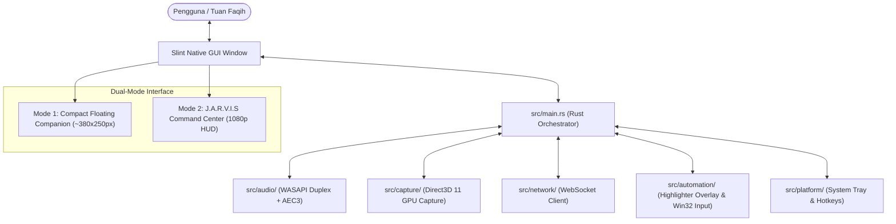
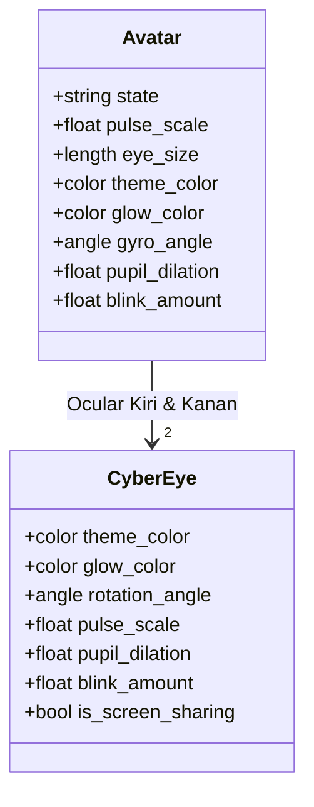
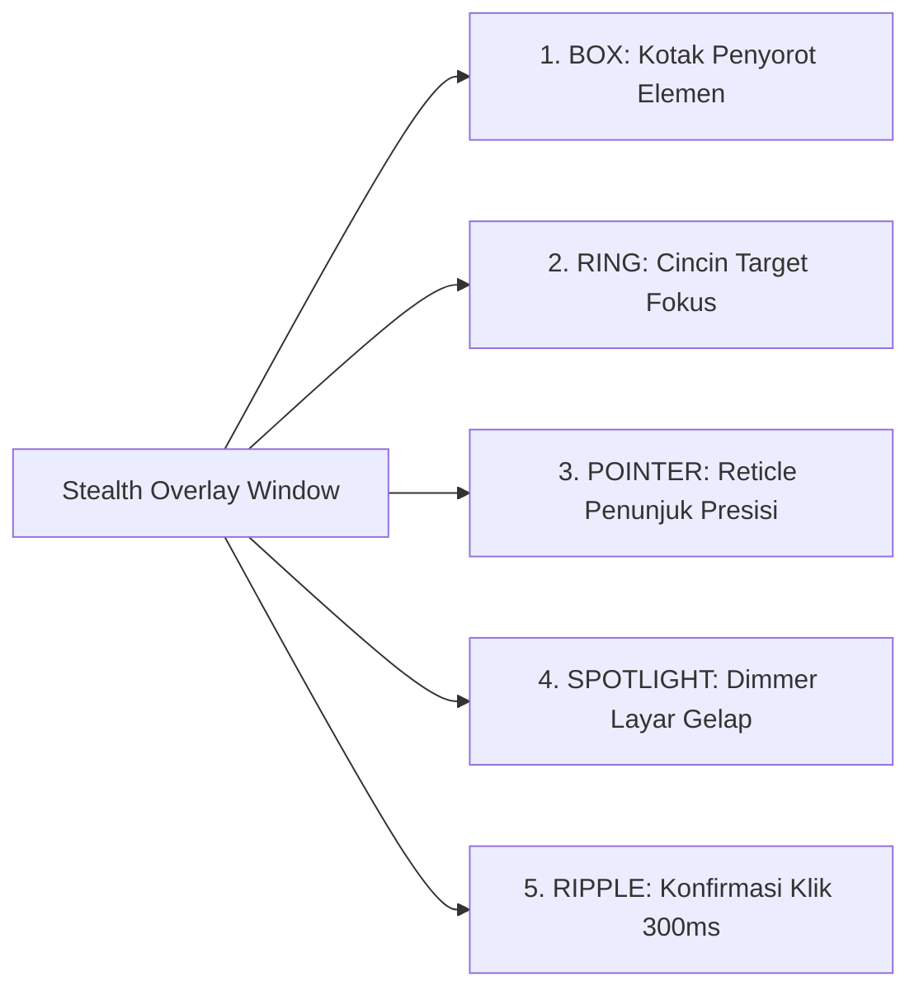

# Spesifikasi Komponen & Antarmuka UI — N.E.X.A Windows Bridge

Dokumen ini merupakan panduan referensi teknis komprehensif mengenai seluruh elemen antarmuka pengguna (UI), teks/label, properti Slint, serta pemetaan fungsi logika kodenya dalam Rust di repositori `nexa-windows-bridge`.

---

## Daftar Isi
1. [Arsitektur UI & Filosofi Desain Dual-Mode](#1-arsitektur-ui--filosofi-desain-dual-mode)
2. [Peta Struktur Berkas Antarmuka Slint](#2-peta-struktur-berkas-antarmuka-slint)
3. [Mode 1: Compact Floating Companion (Widget Mini)](#3-mode-1-compact-floating-companion-widget-mini)
4. [Mode 2: Fullscreen J.A.R.V.I.S Command Center](#4-mode-2-fullscreen-jarvis-command-center)
5. [Komponen Inti: Sentient Cybernetic Avatar](#5-komponen-inti-sentient-cybernetic-avatar)
6. [Komponen Inti: Real-Time Audio Equalizer](#6-komponen-inti-real-time-audio-equalizer)
7. [Komponen Dialog: Settings Modal](#7-komponen-dialog-settings-modal)
8. [Komponen Transparan: Stealth Overlay Window](#8-komponen-transparan-stealth-overlay-window)
9. [Menu Konteks Tray & Global Hotkeys](#9-menu-konteks-tray--global-hotkeys)
10. [Tabel Pemetaan Komprehensif: Properti, Callback & Kode Rust](#10-tabel-pemetaan-komprehensif-properti-callback--kode-rust)

---

## 1. Arsitektur UI & Filosofi Desain Dual-Mode

Aplikasi **N.E.X.A Windows Bridge** dirancang menggunakan toolkit GUI deklaratif **Slint** yang dikompilasi langsung menjadi kode native mesin (C++/Rust FFI) tanpa *runtime overhead* Chromium/Electron. Hasilnya adalah antarmuka ultra-responsif dengan konsumsi memori fisik RAM sangat hemat (<25 MB) serta footprint CPU mendekati 0% saat diam.



### Karakteristik Dual-Mode:
1. **Mode 1 — Compact Floating Companion (Standar):**
   * **Dimensi:** `preferred-width: 380px`, `preferred-height: 250px`, `min-width: 360px`, `min-height: 220px`.
   * **Tujuan:** Widget mini melayang di pojok layar laptop Lenovo ThinkPad X380 Yoga. Tidak mengganggu pandangan saat bekerja, namun selalu menampilkan status kesiapan N.E.X.A, mini avatar siber, audio meter reaktif, dan kendali cepat.
   * **Batasan Tata Letak:** Baris tombol terkunci ketat pada `height: 36px` agar tidak melar secara vertikal saat jendela diubah ukurannya.

2. **Mode 2 — J.A.R.V.I.S Command Center (Layar Penuh / Expanded):**
   * **Dimensi:** `preferred-width: 1920px`, `preferred-height: 1080px`.
   * **Trigger:** Tombol `[F11]`, tombol `⤢ Command Center`, atau bila jendela ditarik/dimaksimalkan (`root.width > 600px || root.height > 420px`).
   * **Tujuan:** Pengalaman HUD futuristik bertaraf J.A.R.V.I.S dengan telemetri *real-time* (CPU, RAM, WASAPI Audio, Latensi Ping), Avatar raksasa 120px dengan orbit giroskopis berputar, audio visualizer 48-bar spektrum penuh, dan floating action dock.

3. **Logika Transisi Responsif (`is_expanded_view`):**
   ```slint
   property <bool> is_expanded_view: root.is_fullscreen || root.width > 600px || root.height > 420px;
   ```
   *Ketika pengguna menekan tombol Maximize bawaan Windows Titlebar, ukuran jendela membesar melampaui 600x420px sehingga antarmuka secara dinamis beralih ke tata letak HUD Command Center tanpa glitch.*

---

## 2. Peta Struktur Berkas Antarmuka Slint

Semua berkas markup antarmuka berada di folder `ui/`:

| Path Berkas | Komponen Utama | Peran & Deskripsi |
| :--- | :--- | :--- |
| `ui/main_window.slint` | `MainWindow` | Jendela utama aplikasi yang menaungi Mode 1 Companion, Mode 2 Command Center, FocusScope keyboard, dan kontainer modal dialog. |
| `ui/settings_dialog.slint` | `SettingsDialog` | Modal dialog pengaturan parameter koneksi WebSocket, token autentikasi, opsi ultra-low RAM, dan toggle autostart Windows. |
| `ui/components/avatar.slint` | `Avatar`, `CyberEye` | Komponen visual wajah siber dua mata dengan 9 spektrum warna kognitif, rotasi giroskopik orbit, kedipan kelopak mata natural, dan pupil adaptif. |
| `ui/components/audio_meter.slint` | `AudioMeter` | Visualizer spektrum gelombang suara parametrik multi-bar yang bergerak dinamis mengikuti level RMS audio mikrofon & respon suara AI. |
| `ui/overlay_window.slint` | `OverlayWindow` | Jendela transparan *click-through* DirectComposition Win32 untuk menggambar bounding box, target ring, pointer, dan click ripple otomasi. |

---

## 3. Mode 1: Compact Floating Companion (Widget Mini)

Mode ini aktif saat `!root.is_expanded_view` (ukuran jendela ringkas ~380x250px).

```
+-------------------------------------------------------+
| [O] N.E.X.A Bridge            [⤢ Command Center] [⚙]  | <- Top Header Bar (28px)
+-------------------------------------------------------+
| +---------------------------------------------------+ |
| | [O O] Avatar  |  Mendengarkan Tuan Faqih...       | | <- Companion Card (86px)
| | (Mini 52px)   |  Ready to connect.                | |
| |               |  |||||||||||||||||| Audio Meter   | |
| +---------------------------------------------------+ |
+-------------------------------------------------------+
|    (o) WASAPI 48kHz    (o) AEC3 Active    (o) D3D11   | <- Hardware Pills (18px)
+-------------------------------------------------------+
| [ 🎙️ Mute ]        [ 👁️ Berbagi Layar ]   [ Hubungkan ]| <- Quick Action Bar (36px)
+-------------------------------------------------------+
```

### Rincian Elemen Mode 1:

#### A. Top Header Bar (`height: 28px`)
1. **Lampu Indikator Status Titik (Status Dot)**
   * **Bentuk:** Bulatan 8x8px (`border-radius: 4px`).
   * **Warna Dinamis:**
     * `#00E5FF` (Cyan): Saat `connection_status == "connected"`
     * `#FF9100` (Amber): Saat `connection_status == "connecting"`
     * `#546E7A` (Slate Gray): Saat `connection_status == "offline"`
   * **Kode Sumber Slint:** `ui/main_window.slint` (L106-L113).
   * **Backend Rust:** Dikendalikan oleh `main_window.set_connection_status()` di `src/main.rs` (L308-L343) melalui langganan `network_client.subscribe_state()`.

2. **Teks Judul Antarmuka**
   * **Teks:** `"N.E.X.A Bridge"`
   * **Tipografi:** Font Segoe UI, ukuran 13px, weight 700 (Bold), warna `#58A6FF`.
   * **Kode Sumber Slint:** `ui/main_window.slint` (L114-L120).

3. **Tombol "⤢ Command Center [F11]"**
   * **Teks:** `"⤢ Command Center [F11]"`
   * **Fungsi:** Mengubah tampilan dari jendela mini menjadi Mode 2 Fullscreen Command Center.
   * **Aksi Klik (`clicked`):**
     ```slint
     root.is_fullscreen = true;
     root.toggle_fullscreen();
     ```
   * **Backend Rust:** Memicu callback `main_window.on_toggle_fullscreen()` di `src/main.rs` (L766-L775) yang memanggil `win.window().set_fullscreen(true)`.

4. **Tombol "⚙ Settings"**
   * **Teks:** `"⚙ Settings"`
   * **Fungsi:** Membuka dialog pengaturan modal overlay di atas jendela.
   * **Aksi Klik (`clicked`):** `root.show_settings = !root.show_settings;`
   * **Kode Sumber Slint:** `ui/main_window.slint` (L132-L135).

---

#### B. Central Companion Card (`height: 86px`, Background `#161B22CC`)
Wadah berbentuk kartu dengan sudut melengkung 8px dan border `#30363D` 1px:

1. **Sub-Komponen Avatar Mini (`Avatar`)**
   * **Dimensi:** `width: 130px`, `height: 52px`, `eye_size: 44px`.
   * **Binding Properti:** `state: root.avatar_state`, `pulse_scale: root.pulse_scale`.
   * **Deskripsi:** Menampilkan sepasang mata siber berskala mini yang berkedip natural dan bereaksi terhadap suara.
   * **Kode Sumber Slint:** `ui/main_window.slint` (L156-L162).

2. **Teks Status Kognitif Primer (`root.status_text_display`)**
   * **Teks Tampil (Paritas 100% Mobile Bridge):**
     * `"Mendengarkan Tuan Faqih..."` (Cyan `#00B4D8`)
     * `"Sedang menalar & memproses..."` (Gold `#FFB300`)
     * `"N.E.X.A sedang berbicara..."` (Emerald `#00FF88`)
     * `"Mendengarkan interupsi Tuan..."` (White Cyan `#C9D1D9`)
     * `"Mentransmisikan layar & audio (D3D11 1 FPS)..."` (Azure `#C9D1D9`)
     * `"Mengeksekusi perintah sistem..."` (Purple `#C9D1D9`)
     * `"Menghubungkan kembali ke server..."` (Amber `#C9D1D9`)
     * `"Online & Siaga"` (Cyan `#00E5FF`)
     * `"Bridge Terputus (Offline)"` (Gray `#C9D1D9`)
   * **Tipografi:** Ukuran 13px, weight 700 (Bold), `overflow: elide`.
   * **Kode Sumber Slint:** `ui/main_window.slint` (L62-L71 & L169-L179).

3. **Teks Pesan Detail / Subtitle (`root.status_message`)**
   * **Teks Tampil:** Contoh `"Ready to connect."`, `"Menghubungkan kembali ke server dalam 1500ms (Percobaan #2)"`, atau transkrip percakapan terakhir.
   * **Tipografi:** Ukuran 11px, warna `#8B949E`, `overflow: elide`.
   * **Kode Sumber Slint:** `ui/main_window.slint` (L180-L185).
   * **Backend Rust:** Diperbarui secara asinkron dari pesan WebSocket `ServerMessage::StatusUpdate` di `src/main.rs` (L415-L434).

4. **Visualizer Spektrum Suara Mini (`AudioMeter`)**
   * **Parameter:** `bar_count: 18`, `bar_width: 3px`, `bar_spacing: 2px`, `max_bar_height: 16px`.
   * **Binding Properti:** `volume_level: root.volume_level`, `is_active: root.avatar_state == "speaking" || root.avatar_state == "listening"`.
   * **Warna:** Menyesuaikan warna state kognitif aktif.
   * **Kode Sumber Slint:** `ui/main_window.slint` (L188-L200).

---

#### C. Baris Pil Status Hardware (`Hardware Indicators Pill Row`, `height: 18px`)
Tiga pil indikator di bagian bawah yang mengonfirmasi kesiapan periferal sistem:

1. **Audio Pill (Mikrofon WASAPI)**
   * **Titik Status:** Hijau `#3FB950` jika tersambung, Amber `#FF9100` jika dibisukan (Muted), Abu-abu `#8B949E` jika offline.
   * **Teks:** `"Mic Muted"` jika dibisukan, atau `"WASAPI 48kHz"` jika aktif.
   * **Kode Sumber Slint:** `ui/main_window.slint` (L211-L226).

2. **Echo Canceller Pill (AEC3)**
   * **Titik Status:** Hijau `#3FB950` saat online, Abu-abu `#8B949E` saat offline.
   * **Teks:** `"AEC3 Active"` (Mengonfirmasi WebRTC AEC3 DSP aktif membatalkan gema speaker).
   * **Kode Sumber Slint:** `ui/main_window.slint` (L229-L244).

3. **Vision Pill (Direct3D 11 Capture)**
   * **Titik Status:** Cyan `#00E5FF` saat transmisi aktif, Hijau `#3FB950` saat standby tersambung, Abu-abu `#8B949E` saat offline.
   * **Teks:** `"D3D11 Streaming"` saat berbagi layar aktif, atau `"D3D11 Vision"` saat standby.
   * **Kode Sumber Slint:** `ui/main_window.slint` (L247-L263).

---

#### D. Baris Tombol Aksi Cepat (`Quick Control Action Bar`, `height: 36px`)
Tiga tombol aksi utama dengan ketinggian tetap 36px agar proporsional dan tidak meregang:

1. **Tombol "Mute / Unmute"**
   * **Teks Dinamis:** `"🔇 Unmute"` (saat `is_mic_muted == true`) atau `"🎙️ Mute"` (saat tidak dibisukan).
   * **Aksi Klik (`clicked`):**
     ```slint
     root.is_mic_muted = !root.is_mic_muted;
     root.toggle_mic_mute();
     ```
   * **Backend Rust:** Memicu callback `main_window.on_toggle_mic_mute()` di `src/main.rs` (L778-L790) yang mengeksekusi `engine.set_mic_muted(muted)` pada WASAPI duplex audio engine.

2. **Tombol "Berbagi Layar"**
   * **Teks Dinamis:** `"⏹️ Hentikan Layar"` (saat aktif) atau `"👁️ Berbagi Layar"` (saat standby).
   * **Aksi Klik (`clicked`):** `root.toggle_screen_share();`
   * **Backend Rust:** Memicu callback `main_window.on_toggle_screen_share()` di `src/main.rs` (L793-L796) yang mengaktifkan/menonaktifkan pipeline `ScreenCaptureController` Direct3D 11 pada 1 FPS ke WebSocket.

3. **Tombol "Hubungkan / Putuskan Sambungan"**
   * **Teks Dinamis:**
     * `"Putuskan"`: Saat terhubung (`connection_status == "connected"`)
     * `"Menghubungkan..."`: Saat proses negosiasi WebSocket (`connection_status == "connecting"`)
     * `"Hubungkan ke Server"`: Saat terputus (`connection_status == "offline"`)
   * **Gaya Tombol:** `primary: root.connection_status != "connected"` (Tombol berwarna biru aksen utama saat offline).
   * **Aksi Klik (`clicked`):** `root.toggle_connect();`
   * **Backend Rust:** Memicu callback `main_window.on_toggle_connect()` di `src/main.rs` (L756-L762) yang memanggil `net_client.connect()` atau `net_client.disconnect()`.

---

## 4. Mode 2: Fullscreen J.A.R.V.I.S Command Center

Mode ini aktif saat `root.is_expanded_view == true` (Layar Penuh `F11` atau jendela ditarik melebihi 600x420px).

```
+-----------------------------------------------------------------------------------------+
| [ CPU: 12% | RAM: 34% | WASAPI: Active | AEC3: Active | Latency: 24ms ]  [⤡ Windowed] [⚙]| <- HUD Telemetry (44px)
+-----------------------------------------------------------------------------------------+
|                                                                                         |
|                                       [O       O]                                       | <- Cybernetic Avatar
|                                 (Raksasa Ocular 120px)                                  |    (Orbital Rotating)
|                                                                                         |
|                               Mendengarkan Tuan Faqih...                                 | <- Status Text (24px Bold)
|                                   N.E.X.A Siaga                                         | <- Subtitle (14px)
|                                                                                         |
|                          ||||||||||||||||||||||||||||||||||||||                         | <- Wide Spectrum (48 Bars)
|                                                                                         |
+-----------------------------------------------------------------------------------------+
|        ( [🎙️ Mute Mic]   [👁️ Berbagi Layar (1 FPS)]   [Putuskan]   💡 [F11] Shortcut )       | <- Floating Action Dock (52px)
+-----------------------------------------------------------------------------------------+
```

### Rincian Elemen Mode 2:

#### A. Top HUD Telemetry Bar (`height: 44px`)
Panel telemetri transparan (`#161B22CC`) di bagian atas yang menyajikan metrik sistem *live*:

1. **Indikator Beban Prosesor:** `"💻 CPU: " + root.telemetry_cpu` (Font 12px, warna `#58A6FF`).
2. **Indikator Konsumsi Memori:** `"🧠 RAM: " + root.telemetry_ram` (Font 12px, warna `#58A6FF`).
3. **Indikator Status Audio:** `"🎙️ WASAPI Audio: " + (root.connection_status == "connected" ? "Active (16kHz)" : "Standby")` (Warna hijau `#3FB950` jika aktif).
4. **Indikator Status Echo Canceller:** `"🛡️ AEC3: " + (root.connection_status == "connected" ? "Active (-18dB)" : "Standby")`.
5. **Indikator Latensi Jaringan:** `"⚡ Latency: " + root.telemetry_ping` (Warna `#79C0FF`).
   * **Backend Rust Telemetri:** Diperbarui setiap 2 detik via Tokio interval di `src/main.rs` (L649-L686) menggunakan modul Win32 FFI `SystemTelemetry`.
6. **Tombol "⤡ Windowed Mode [F11]"**
   * **Fungsi:** Mengembalikan jendela ke Mode 1 Companion dan merestorasi ukuran windowed (`root.is_fullscreen = false; root.toggle_fullscreen();`).
   * **Rust:** Di `src/main.rs` (L771-L773) mengeksekusi `win.window().set_maximized(false)` sehingga jendela tidak terjebak dalam ukuran layar penuh.
7. **Tombol "⚙ Settings"**: Membuka dialog pengaturan modal.

---

#### B. Center Stage: Sentient Cybernetic Avatar & Wide Spectrum Equalizer
1. **Avatar Kognitif Raksasa:**
   * **Dimensi:** `width: 340px`, `height: 140px`, `eye_size: 120px`.
   * **Fitur Visual:** Ukuran lensa mata 120px dengan detail cincin orbital giroskopik, pupil berdiameter dinamis, garis pemindai laser jika berbagi layar aktif, dan reaktor inti di tengah.
   * **Kode Sumber Slint:** `ui/main_window.slint` (L373-L379).

2. **Teks Status Sentral:**
   * **Tipografi:** Ukuran 24px, weight 700 (Bold), perataan tengah (`horizontal-alignment: center`).
   * **Warna:** Menyesuaikan status kognitif aktif.

3. **Wide Frequency Spectrum Audio Equalizer:**
   * **Parameter:** `bar_count: 48`, `bar_width: 4px`, `bar_spacing: 4px`, `max_bar_height: 38px`.
   * **Fungsi:** Menghasilkan gelombang visualizer audio lebar melintang di tengah layar HUD Command Center yang meliuk-liuk mengikuti ritme suara pengguna maupun jawaban sintesis vokal N.E.X.A.
   * **Kode Sumber Slint:** `ui/main_window.slint` (L401-L412).

---

#### C. Bottom Fullscreen HUD Action Dock (`height: 52px`)
Dermaga kendali melayang (*floating capsule pill*) dengan latar `#161B22E6` dan radius sudut 20px:
1. **Tombol "🎙️ Mute Mic / 🔇 Unmute Mic"** (Mengendalikan mute mikrofon).
2. **Tombol "👁️ Berbagi Layar (1 FPS) / ⏹️ Hentikan Layar"** (Mengendalikan D3D11 capture).
3. **Tombol "Hubungkan ke Server / Putuskan Sambungan"** (Mengendalikan WebSocket).
4. **Teks Panduan Shortcut:** `"💡 [F11] Layar Penuh | [Win+Alt+N] Boss Key | [Win+Alt+S] Layar"` (Font 11px, warna `#8B949E`).
   * Memberikan referensi cepat tombol pintas global tanpa harus membuka dokumentasi.

---

## 5. Komponen Inti: Sentient Cybernetic Avatar

Berkas `ui/components/avatar.slint` mengimplementasikan wajah siber dua mata (*Dual-Ocular*) dengan inspirasi estetika J.A.R.V.I.S / Arc Reactor.



### 9 Spektrum Warna & Perilaku Kognitif:

| Status (`state`) | Teks Tampil (`status_text_display`) | Kode Hex Warna | Efek Animasi Slint | Perilaku Logika |
| :--- | :--- | :--- | :--- | :--- |
| `idle` | *"Online & Siaga"* | `#00E5FF` (Cyan Lembut) | Berkedip natural setiap 3.5 detik | Bridge standby menunggu ucapan pengguna. |
| `listening` | *"Mendengarkan Tuan Faqih..."* | `#00B4D8` (Vibrant Cyan-Blue) | Pupil melebar (`dilation: 1.25`), denyut audio reaktif | Audio mikrofon dihitung RMS-nya dan ditransmisikan. |
| `thinking` | *"Sedang menalar & memproses..."* | `#FFB300` (Cognitive Gold) | **Rotasi Giroskopik Orbit 360° per 2.0s** (Mata kiri CCW, kanan CW) | Server sedang menjalankan inferensi LLM Gemini. |
| `speaking` | *"N.E.X.A sedang berbicara..."* | `#00FF88` (Cyber Emerald) | Pupil modulasi vokal, denyut iris membesar | Suara AI diterima dan diputar di speaker via WASAPI. |
| `barge_in` | *"Mendengarkan interupsi Tuan..."* | `#E0F7FA` (Flash Cyan) | Denyut kilat putih seketika | Suara AI dihentikan seketika karena pengguna menyela. |
| `screen_sharing`| *"Mentransmisikan layar & audio..."*| `#00B0FF` (Holographic Azure) | **Laser Scanner Bar** menyapu vertikal secara sinusoidal | Direct3D 11 GPU capture aktif mengirim 1 FPS. |
| `tool_executing`| *"Mengeksekusi perintah sistem..."*| `#7C4DFF` (Quantum Violet) | Inti Arc Reactor berdenyut cepat | Otomasi keyboard/mouse/eksekusi aplikasi lokal. |
| `connecting` | *"Menghubungkan kembali..."* | `#FF9100` (Amber) | **Rotasi Giroskopik Cepat 360° per 1.5s** | Percobaan jabat tangan WebSocket dengan *exponential backoff*. |
| `offline` | *"Bridge Terputus (Offline)"* | `#37474F` (Deep Slate Gray) | Kelopak mata tertutup penuh (`blink: 1.0`, mode tidur) | Klien terputus dari server, audio engine non-aktif. |

### Detail Anatomi `CyberEye`:
1. **Static Outer Telemetry Brackets:** Braket HUD sudut lingkaran luar (`theme_color.transparentize(0.7)`).
2. **Rotating Gyroscopic Orbital Ring:** Cincin sirkular yang memiliki 4 penanda telemetri (*top, bottom, left, right ticks*). Berputar otomatis menggunakan properti `transform-rotation` ketika status bernilai `thinking` atau `connecting`.
3. **Dynamic Aperture Eyelid Container:** Kelopak mata dinamis dengan fungsi pemotong (`clip: true`) yang menghitung siklus kedipan (`blink_amount`) berbasis modulo waktu `Math.mod(animation-tick(), 3500ms)`.
4. **Middle Telemetry Pulse Arc:** Cincin denyut tengah yang membesar dan mengecil secara instan sesuai amplitudo suara RMS (`pulse_scale`).
5. **Inner Luminous Iris & Pupil Core:** Iris siber bercahaya dengan inti pupil putih dan specular reflection dot di sudut atas kiri.
6. **Vision Scan Sweep Bar:** Garis horizontal laser biru muda (`#E0F7FA`) yang menyapu naik-turun secara berkala (`sin(animation-tick() / 600ms * 180deg)`) khusus saat berbagi layar aktif.

---

## 6. Komponen Inti: Real-Time Audio Equalizer

Berkas `ui/components/audio_meter.slint` mengimplementasikan visualizer frekuensi parametrik:
* **Properti:**
  * `volume_level`: Nilai desimal float berkisar antara `0.0` sampai `1.0` (RMS volume audio *real-time*).
  * `is_active`: Boolean, aktif saat N.E.X.A berbicara atau saat mendengarkan pengguna.
  * `bar_count`: Jumlah batang visualizer (18 batang di Mode 1, 48 batang di Mode 2).
  * `bar_width`: Lebar tiap batang (3px di Mode 1, 4px di Mode 2).
  * `max_bar_height`: Ketinggian puncak gelombang (16px di Mode 1, 38px di Mode 2).
* **Fungsi Matematika Gerak Gelombang:**
  Tinggi batang dihitung menggunakan kombinasi kurva distribusi normal Gaussian dan interferensi dua gelombang sinusoidal:
  ```slint
  root.min_bar_height + (root.max_bar_height - root.min_bar_height) *
      max(0.1, (1.0 - ((i - (root.bar_count / 2)).abs() / (root.bar_count / 2.0)) * 0.6)) *
      (root.is_active ? ((sin((i * 24deg) + (animation-tick() / 120ms * 180deg)) * 0.6 +
                          cos((i * 36deg) - (animation-tick() / 180ms * 180deg)) * 0.4).abs()) : 0.0) *
      max(0.0, root.volume_level);
  ```
  *Rumus ini menghasilkan visualisasi frekuensi tengah yang lebih tinggi secara alami mirip equalizer studio audio profesional.*

---

## 7. Komponen Dialog: Settings Modal

Berkas `ui/settings_dialog.slint` mengimplementasikan dialog modal berlatar `#1A1F2C` dengan border `#2D3748`. Pada `main_window.slint`, dialog ini dibatasi secara ketat agar tidak pernah meregang memenuhi layar:
```slint
SettingsDialog {
    width: min(500px, parent.width - 32px);
    height: min(460px, parent.height - 32px);
    x: (parent.width - self.width) / 2;
    y: (parent.height - self.height) / 2;
    ...
}
```

```
+-------------------------------------------------------+
| Bridge Settings                                       | <- Header (17px Bold)
|                                                       |
| Server Endpoint (WebSocket)                           |
| [ wss://nexa-server.example.com/ws                  ] | <- URL Input (34px)
|                                                       |
| Device Authorization Token                            |
| [ ************************************************* ] | <- Password Token (34px)
|                                                       |
| Performance & Startup                                 |
| [x] Ultra-Low RAM Mode (<25MB, Lean Buffer)           | <- Checkbox 1
| [ ] Mulai Otomatis saat Windows Menyala (Standby)     | <- Checkbox 2
|                                                       |
| ✅ Handshake Succeeded! Connected & Authenticated.    | <- Test Feedback Text
|                                                       |
|         [ Test Connection ]  [ Save & Apply ] [ Close]| <- Action Bar (36px)
+-------------------------------------------------------+
```

### Rincian Bidang Input & Tombol Settings:

1. **Header Dialog:** `"Bridge Settings"` (Font 17px, bold, warna `#F7FAFC`).
2. **Input Endpoint URL (`url_input`):**
   * **Label:** `"Server Endpoint (WebSocket)"` (Warna `#A0AEC0`).
   * **Placeholder:** `"wss://nexa-server.example.com/ws"`.
   * **Ketinggian:** Terkunci pada `height: 34px`.
   * **Data Binding:** Terhubung ke properti `server_url`.
3. **Input Token Autentikasi (`token_input`):**
   * **Label:** `"Device Authorization Token"`.
   * **Placeholder:** `"Enter secret token"`.
   * **Tipe Input:** `input-type: password;` (Karakter disamarkan demi keamanan privasi).
   * **Ketinggian:** `height: 34px`.
   * **Data Binding:** Terhubung ke properti `auth_token`.
4. **Checkbox Ultra-Low RAM Mode (`low_ram_check`):**
   * **Teks:** `"Ultra-Low RAM Mode (<25MB, Lean Buffer)"`.
   * **Fungsi:** Mengaktifkan buffer hemat memori dan agresif memanggil `SetProcessWorkingSetSize` Win32 saat aplikasi terminimalkan.
   * **Data Binding:** Terhubung ke properti `low_ram_mode`.
5. **Checkbox Mulai Otomatis Windows (`autostart_check`):**
   * **Teks:** `"Mulai Otomatis saat Windows Menyala (Standby di Tray)"`.
   * **Fungsi:** Menulis registry Windows pada path `HKCU\Software\Microsoft\Windows\CurrentVersion\Run` dengan argumen `--autostart` agar aplikasi siap di System Tray saat laptop menyala.
   * **Data Binding:** Terhubung ke properti `autostart`.
6. **Teks Umpan Balik Pengujian Jaringan (`test_status_text`):**
   * **Teks Tampil:** `"Testing connection..."`, `"✅ Handshake Succeeded! Connected & Authenticated."`, atau `"❌ Failed: [error]"`.
   * **Warna:** Hijau `#48BB78`.
7. **Tombol "Test Connection":**
   * **Teks Dinamis:** `"Testing..."` (saat pengujian berlangsung) atau `"Test Connection"`.
   * **Fungsi:** Menjalankan jabat tangan uji coba TCP & WebSocket langsung ke endpoint dengan membawa header `Authorization: Bearer <token>` tanpa mengganggu sesi aktif.
   * **Backend Rust:** `main_window.on_test_connection()` -> `test_ws_handshake()` di `src/main.rs` (L721-L754).
8. **Tombol "Save & Apply":**
   * **Gaya:** `primary: true` (Aksen biru mencolok).
   * **Fungsi:** Menyimpan konfigurasi ke file `~/.nexa-bridge.json` dan memperbarui status autostart registry Windows.
   * **Backend Rust:** `main_window.on_save_settings()` di `src/main.rs` (L691-L718).
9. **Tombol "Close":**
   * **Fungsi:** Menutup modal overlay pengaturan dan kembali ke tampilan utama (`root.show_settings = false;`).

---

## 8. Komponen Transparan: Stealth Overlay Window

Berkas `ui/overlay_window.slint` mendefinisikan jendela transparan tingkat atas (*click-through window*) yang mencakup seluruh resolusi layar primer (1920x1080px) tanpa batas tepi (`no-frame: true; always-on-top: true; background: transparent;`).

### 5 Gaya Visualisasi Otomasi UI:



1. **Gaya `BOX` (Bounding Box):**
   * **Visual:** Kotak persegi panjang dengan border cyan tebal 2.5px (`#00E5FF`), latar transparan 10% (`#00E5FF18`), sudut kurva 6px, serta penanda presisi (*precision ticks*) di sudut kiri atas dan kanan bawah.
   * **Floating Label Tag:** Tag label melayang di atas kotak berlatar hitam transparan (`#0B0F19F0`) yang menampilkan nama elemen yang dikenali oleh agen AI (misalnya: `"Search Bar"`, `"Save Button"`).
2. **Gaya `RING` (Cincin Target):**
   * **Visual:** Lingkaran cyan 60x60px tepat di titik koordinat sasaran dengan titik fokus konsentris 8px di tengahnya.
3. **Gaya `POINTER` (Reticle Penunjuk):**
   * **Visual:** Titik sasaran pulsasi 32x32px dengan lingkaran luar konsentris dan label melayang di sisi kanan.
4. **Gaya `SPOTLIGHT`:**
   * **Visual:** Seluruh layar diredupkan dengan latar hitam transparan 40% (`#00000066`), sementara area elemen sasaran disorot terang.
5. **Indikator `RIPPLE` (Click Confirmation Ripple):**
   * **Visual:** Lingkaran riak cyan yang mengembang dan memudar selama 300ms tepat di koordinat klik mouse untuk memberikan konfirmasi visual bahwa agen telah mengeksekusi klik.
* **Backend Rust:** Dikelola oleh `automation::HighlighterController` di `src/automation/highlighter.rs` dengan atribut Win32 `WS_EX_LAYERED | WS_EX_TRANSPARENT` sehingga mouse pengguna dapat mengklik menembus jendela overlay tanpa hambatan.

---

## 9. Menu Konteks Tray & Global Hotkeys

Aplikasi berjalan senyap di latar belakang sistem Windows menggunakan Win32 Native API (`Shell_NotifyIconW` dan `RegisterHotKey`).

### A. Menu Konteks Klik-Kanan System Tray
Tersedia saat mengklik kanan ikon N.E.X.A di taskbar notification area:

| Item Menu | Label Persis | ID Menu | Aksi & Logika Rust |
| :--- | :--- | :--- | :--- |
| 1 | `👁️ Buka N.E.X.A` | `1001` | Memulihkan jendela dari status minimize/sembunyi dan membawanya ke latar depan. |
| 2 | `🎙️ Mute / Unmute Mikrofon` | `1002` | Membalikkan status mute mikrofon WASAPI secara instan. |
| 3 | `🖥️ Mulai / Hentikan Layar (Win+Alt+S)` | `1006` | Menyalakan atau mematikan penangkapan layar Direct3D 11. |
| 4 | `⛶ Layar Penuh / Jendela (F11)` | `1003` | Beralih antara Mode 1 Companion dan Mode 2 Fullscreen Command Center. |
| 5 | `⚙ Pengaturan (~/.nexa-bridge.json)` | `1004` | Membuka jendela aplikasi dan langsung menampilkan modal SettingsDialog. |
| -- | *(Separator Garis Pemisah)* | `0` | Pembatas visual. |
| 6 | `❌ Keluar` | `1005` | Menghentikan audio engine, capture, dan mematikan event loop Slint secara bersih. |

> **Catatan Interaksi Klik Kiri:** Mengklik kiri ikon System Tray akan memicu event `TrayEvent::ToggleWindow` yang bertindak sebagai tombol sakelar cepat (menyembunyikan jendela jika terlihat, atau memunculkan jendela jika tersembunyi).

### B. Pintasan Keyboard Global (Global Hotkeys)
Dapat ditekan kapan saja dari aplikasi apa pun (background listening):

| Tombol Pintas | Aksi | Implementasi Kode | Fungsi |
| :--- | :--- | :--- | :--- |
| `Win + Alt + N` | **Boss Key** | `HotkeyAction::BossKey` | Menyembunyikan jendela N.E.X.A ke System Tray seketika saat ada orang lain mendekat, atau memanggilnya kembali. |
| `Win + Alt + M` | **Mute Mikrofon** | `HotkeyAction::ToggleMute` | Membisukan/mengaktifkan kembali mikrofon laptop tanpa perlu membuka aplikasi. |
| `Win + Alt + S` | **Screen Share** | `HotkeyAction::ToggleScreenShare` | Memulai/menghentikan transmisi video D3D 11 ke server secara global. |
| `F11` / `Win + Alt + F` | **Fullscreen Toggle** | `HotkeyAction::ToggleFullscreen` | Memperbesar antarmuka ke mode J.A.R.V.I.S HUD atau kembali ke mode widget ringkas. |
| `Escape` | **Keluar Fullscreen / Modal** | In-app `FocusScope` | Menutup dialog pengaturan jika terbuka, atau keluar dari layar penuh jika sedang fullscreen. |

---

## 10. Tabel Pemetaan Komprehensif: Properti, Callback & Kode Rust

Tabel berikut memetakan setiap properti dan callback Slint pada `MainWindow` ke definisi tipe dan penanganannya dalam kode Rust:

| Properti / Callback Slint | Tipe Data | Nilai Default | Penanganan di Kode Rust | Lokasi Berkas & Baris |
| :--- | :--- | :--- | :--- | :--- |
| `is_fullscreen` | `bool` | `false` | Disinkronkan dengan status `win.window().set_fullscreen()` | `src/main.rs:766-775` |
| `is_mic_muted` | `bool` | `false` | Memanggil `audio_engine.set_mic_muted(muted)` | `src/main.rs:778-790` |
| `is_screen_sharing` | `bool` | `false` | Mengaktifkan/menonaktifkan `ScreenCaptureController` | `src/main.rs:126-206` |
| `connection_status` | `string` | `"offline"` | Diperbarui dari state WebSocket (`connected`, `connecting`, `offline`) | `src/main.rs:307-353` |
| `avatar_state` | `string` | `"offline"` | 9 cognitive states (`CognitiveState::as_str()`) | `src/ui/mod.rs:27-39` |
| `pulse_scale` | `float` | `1.0` | Dihitung dari level RMS audio respons atau suara mic pengguna | `src/main.rs:240, 383` |
| `volume_level` | `float` | `0.0` | Level RMS 0.0-1.0 untuk menggerakkan bilah equalizer | `src/main.rs:239, 382` |
| `status_message` | `string` | `"Siap terhubung..."`| Pesan status detail atau subtitle transkrip percakapan | `src/main.rs:428-431` |
| `show_settings` | `bool` | `false` | Mengontrol visibilitas modal dialog pengaturan | `src/main.rs:584, 802` |
| `telemetry_cpu` | `string` | `"12%"` | Diperbarui setiap 2 detik dari `SystemTelemetry::sample_cpu_percent()` | `src/main.rs:669` |
| `telemetry_ram` | `string` | `"34%"` | Diperbarui setiap 2 detik dari `SystemTelemetry::sample_ram_percent()` | `src/main.rs:670` |
| `telemetry_audio` | `string` | `"WASAPI 48kHz..."` | Mengonfirmasi status driver WASAPI & pembatalan gema AEC3 | `src/main.rs:673-676` |
| `telemetry_ping` | `string` | `"24ms"` | Menampilkan latensi koneksi WebSocket ke server | `src/main.rs:679-682` |
| `cfg_server_url` | `string` | `""` | Disinkronkan dengan `BridgeConfig.server_url` | `src/main.rs:89, 704` |
| `cfg_auth_token` | `string` | `""` | Disinkronkan dengan `BridgeConfig.auth_token` | `src/main.rs:90, 705` |
| `cfg_low_ram_mode` | `bool` | `true` | Disinkronkan dengan `BridgeConfig.low_ram_mode` | `src/main.rs:91, 706` |
| `cfg_autostart` | `bool` | `false` | Disinkronkan dengan `platform::is_autostart_enabled()` | `src/main.rs:92, 707` |
| `test_status_text` | `string` | `""` | Menampilkan hasil tes jabat tangan WebSocket Bearer auth | `src/main.rs:742, 747` |
| `is_testing` | `bool` | `false` | Mengunci tombol pengujian saat koneksi sedang diuji | `src/main.rs:727, 739` |
| `toggle_connect()` | *callback* | -- | Memanggil `net_client.connect()` atau `net_client.disconnect()` | `src/main.rs:756-762` |
| `toggle_fullscreen()`| *callback* | -- | Memanggil `win.window().set_fullscreen()` & mengatur bounds | `src/main.rs:766-775` |
| `toggle_mic_mute()` | *callback* | -- | Memanggil `engine.set_mic_muted()` pada audio subsystem | `src/main.rs:778-790` |
| `toggle_screen_share()`| *callback*| -- | Mengontrol hidup/mati GPU Direct3D 11 screen capture | `src/main.rs:793-796` |
| `open_settings()` | *callback* | -- | Membuka modal pengaturan (`win.set_show_settings(true)`) | `src/main.rs:799-804` |
| `save_settings()` | *callback* | -- | Menyimpan konfigurasi ke file disk JSON dan Windows Registry | `src/main.rs:691-718` |
| `test_connection()` | *callback* | -- | Menjalankan fungsi asinkron `test_ws_handshake()` | `src/main.rs:721-754` |

---

## 11. Kesimpulan & Verifikasi Kualitas
Dokumentasi ini mencakup secara menyeluruh setiap elemen antarmuka, label teks bahasa Indonesia maupun istilah teknis, properti Slint, serta pemetaannya ke kode backend Rust. Seluruh elemen UI dibangun di atas prinsip keandalan, ketepatan fungsionalitas, performa hemat sumber daya pada Lenovo ThinkPad X380 Yoga, dan kepatuhan penuh terhadap arsitektur N.E.X.A Server dan Mobile Bridge.
