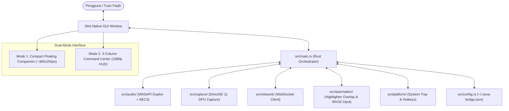
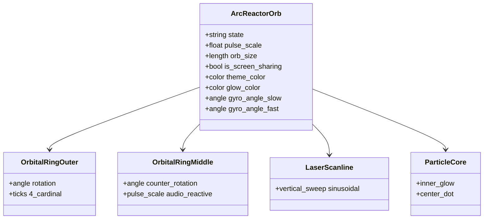
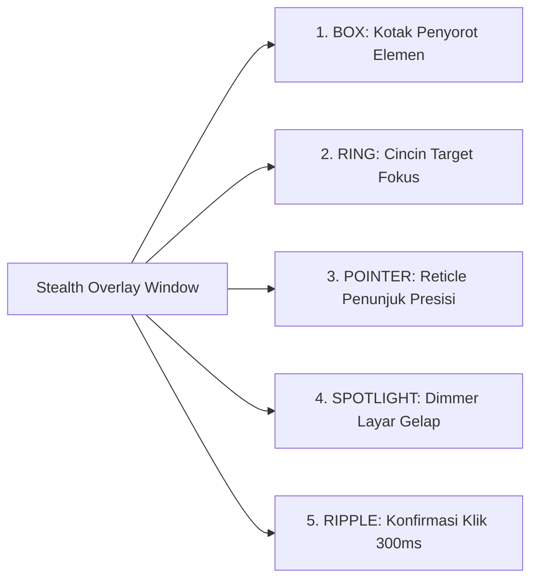

# Spesifikasi Komponen & Antarmuka UI — N.E.X.A Windows Bridge

Dokumen ini merupakan panduan referensi teknis komprehensif mengenai seluruh elemen antarmuka pengguna (UI), teks/label, properti Slint, serta pemetaan fungsi logika kodenya dalam Rust di repositori `nexa-windows-bridge`.

---

## Daftar Isi
1. [Arsitektur UI & Filosofi Desain Dual-Mode](#1-arsitektur-ui--filosofi-desain-dual-mode)
2. [Peta Struktur Berkas Antarmuka Slint](#2-peta-struktur-berkas-antarmuka-slint)
3. [Mode 1: Compact Floating Companion (Widget Mini)](#3-mode-1-compact-floating-companion-widget-mini)
4. [Mode 2: 3-Column Futuristic Command Center (Layar Penuh / HUD)](#4-mode-2-3-column-futuristic-command-center-layar-penuh--hud)
5. [Komponen Inti: Arc Reactor Sentient Core](#5-komponen-inti-arc-reactor-sentient-core)
6. [Komponen Inti: Real-Time Audio Equalizer](#6-komponen-inti-real-time-audio-equalizer)
7. [Komponen Modular HUD: Vision, Automation, Transcript, Telemetry & Hotkeys](#7-komponen-modular-hud-vision-automation-transcript-telemetry--hotkeys)
8. [Komponen Dialog: Modular Settings Modal](#8-komponen-dialog-modular-settings-modal)
9. [Komponen Transparan: Stealth Overlay Window](#9-komponen-transparan-stealth-overlay-window)
10. [Menu Konteks Tray & Global Hotkeys](#10-menu-konteks-tray--global-hotkeys)
11. [Tabel Pemetaan Komprehensif: Properti, Callback & Kode Rust](#11-tabel-pemetaan-komprehensif-properti-callback--kode-rust)
12. [Kesimpulan & Verifikasi Kualitas](#12-kesimpulan--verifikasi-kualitas)

---

## 1. Arsitektur UI & Filosofi Desain Dual-Mode

Aplikasi **N.E.X.A Windows Bridge** dirancang menggunakan toolkit GUI deklaratif **Slint** yang dikompilasi langsung menjadi kode native mesin (C++/Rust FFI) tanpa *runtime overhead* Chromium/Electron. Hasilnya adalah antarmuka ultra-responsif dengan konsumsi memori fisik RAM sangat hemat (<25 MB) serta footprint CPU mendekati 0% saat diam.



### Karakteristik Dual-Mode:
1. **Mode 1 — Compact Floating Companion (Standar):**
   * **Dimensi:** `preferred-width: 380px`, `preferred-height: 250px`, `min-width: 360px`, `min-height: 220px`.
   * **Tujuan:** Widget mini melayang di pojok layar laptop Lenovo ThinkPad X380 Yoga. Tidak mengganggu pandangan saat bekerja, namun selalu menampilkan status kesiapan N.E.X.A, Arc Reactor mini 58px, audio meter reaktif, dan kendali cepat.
   * **Batasan Tata Letak:** Baris tombol terkunci ketat pada `height: 36px` agar tidak melar secara vertikal saat jendela diubah ukurannya.

2. **Mode 2 — 3-Column Futuristic Command Center (Layar Penuh / Expanded):**
   * **Dimensi:** `preferred-width: 1920px`, `preferred-height: 1080px`.
   * **Trigger:** Tombol `[F11]`, tombol `⤢ Command Center`, atau bila jendela ditarik/dimaksimalkan (`root.width > 600px || root.height > 420px`).
   * **Tujuan:** Pengalaman HUD futuristik bertaraf J.A.R.V.I.S dengan arsitektur 3-kolom modular:
     * **Kolom Kiri (320px):** Vision Monitor (D3D11 Capture status) + Live Win32 Automation Activity Log.
     * **Kolom Tengah (Fluid):** Arc Reactor Orb Sentient Core (220px) + Audio Spectrum Equalizer + Live Conversation Transcript.
     * **Kolom Kanan (320px):** Telemetri Perangkat Keras (CPU, RAM, Latensi, WASAPI, AEC3) + Pintasan Keyboard Global + Quick Control Dock.
   * **Modularitas Dinamis:** Tiap kartu HUD dapat disembunyikan/ditampilkan melalui menu Pengaturan, dan kolom akan mengerut (*collapse*) secara otomatis jika seluruh kartu di dalamnya dinonaktifkan.

3. **Logika Transisi Responsif (`is_expanded_view`):**
   ```slint
   property <bool> is_expanded_view: root.is_fullscreen || root.width > 600px || root.height > 420px;
   ```
   *Ketika pengguna menekan tombol Maximize bawaan Windows Titlebar, ukuran jendela membesar melampaui 600x420px sehingga antarmuka secara dinamis beralih ke tata letak 3-Column Command Center tanpa glitch.*

---

## 2. Peta Struktur Berkas Antarmuka Slint

Semua berkas markup antarmuka berada di folder `ui/`:

| Path Berkas | Komponen Utama | Peran & Deskripsi |
| :--- | :--- | :--- |
| `ui/main_window.slint` | `MainWindow` | Jendela utama aplikasi yang menaungi Mode 1 Companion, Mode 2 3-Column Command Center, FocusScope keyboard, dan kontainer modal dialog. |
| `ui/settings_dialog.slint` | `SettingsDialog` | Modal dialog pengaturan konfigurasi: WebSocket endpoint, Auth token, opsi low-RAM, autostart Windows, dan 5 checkbox modularitas HUD. |
| `ui/components/arc_reactor.slint` | `ArcReactorOrb`, `ArcReactor` | Komponen visual reaktor fusi cybernetic konsentris dengan rotasi giroskopik ganda, denyut audio RMS, pemindai laser layar, dan 10 warna kognitif. |
| `ui/components/audio_meter.slint` | `AudioMeter` | Visualizer spektrum gelombang suara parametrik multi-bar yang bergerak dinamis mengikuti level RMS audio mikrofon & respon suara AI. |
| `ui/components/vision_card.slint` | `VisionCard` | Kartu monitor D3D11 capture resolusi 1920x1080@1fps, format DXGI duplication, dan tombol pintas kontrol streaming layar. |
| `ui/components/automation_card.slint` | `AutomationCard` | Kartu aktivitas otomasi Win32 real-time dengan 3 log stream dan badge aksi berwarna (CLICK, TYPE, EXECUTE, HIGHLIGHT). |
| `ui/components/transcript_card.slint` | `TranscriptCard` | Kartu transkrip percakapan langsung dua arah dengan gelembung dialog futuristik antara Tuan Faqih dan N.E.X.A. |
| `ui/components/telemetry_card.slint` | `TelemetryCard` | Kartu telemetri sistem dengan graphical meter progress bar untuk CPU, RAM, Latensi, serta status WASAPI 48kHz & AEC3. |
| `ui/components/hotkeys_card.slint` | `HotkeysCard` | Kartu cheatsheet pintasan keyboard global berbalut badge kbd (Win+Alt+N, Win+Alt+M, Win+Alt+S, F11, Esc). |
| `ui/components/avatar.slint` | `Avatar`, `CyberEye` | Komponen dual-ocular legacy (tetap dipertahankan untuk kompatibilitas dan pengujian komparasi visual). |
| `ui/overlay_window.slint` | `OverlayWindow` | Jendela transparan *click-through* DirectComposition Win32 untuk menggambar bounding box, target ring, pointer, dan click ripple otomasi. |

---

## 3. Mode 1: Compact Floating Companion (Widget Mini)

Mode ini aktif saat `!root.is_expanded_view` (ukuran jendela ringkas ~380x250px).

```
+-------------------------------------------------------+
| [O] N.E.X.A Bridge            [⤢ Command Center] [⚙]  | <- Top Header Bar (28px)
+-------------------------------------------------------+
| +---------------------------------------------------+ |
| | (O) ArcReactor |  Mendengarkan Tuan Faqih...      | | <- Companion Card (86px)
| | (Mini 58px)    |  Ready to connect.               | |
| |                |  |||||||||||||||||| Audio Meter  | |
| +---------------------------------------------------+ |
+-------------------------------------------------------+
|    (o) WASAPI 48kHz    (o) AEC3 Active    (o) D3D11   | <- Hardware Pills (18px)
+-------------------------------------------------------+
| [ 🎙️ Mute ]        [ 👁️ Berbagi Layar ]   [ Hubungkan ]| <- Quick Action Bar (36px)
+-------------------------------------------------------+
```

### Rincian Elemen Mode 1:

#### A. Top Header Bar (`height: 28px`)
1. **Lampu Indikator Status Titik (Status Dot)**
   * **Bentuk:** Bulatan 8x8px (`border-radius: 4px`).
   * **Warna Dinamis:**
     * `#00E5FF` (Cyan): Saat `connection_status == "connected"`
     * `#FF9100` (Amber): Saat `connection_status == "connecting"`
     * `#546E7A` (Slate Gray): Saat `connection_status == "offline"`
   * **Kode Sumber Slint:** `ui/main_window.slint`.
   * **Backend Rust:** Dikendalikan oleh `main_window.set_connection_status()` di `src/main.rs` melalui langganan `network_client.subscribe_state()`.

2. **Teks Judul Antarmuka**
   * **Teks:** `"N.E.X.A Bridge"`
   * **Tipografi:** Font Segoe UI, ukuran 13px, weight 700 (Bold), warna `#58A6FF`.

3. **Tombol "⤢ Command Center [F11]"**
   * **Teks:** `"⤢ Command Center [F11]"`
   * **Fungsi:** Mengubah tampilan dari jendela mini menjadi Mode 2 Fullscreen Command Center.
   * **Aksi Klik (`clicked`):** `root.is_fullscreen = true; root.toggle_fullscreen();`
   * **Backend Rust:** Memicu callback `main_window.on_toggle_fullscreen()` di `src/main.rs` yang memanggil `win.window().set_fullscreen(true)`.

4. **Tombol "⚙ Settings"**
   * **Teks:** `"⚙ Settings"`
   * **Fungsi:** Membuka dialog pengaturan modal overlay di atas jendela.
   * **Aksi Klik (`clicked`):** `root.show_settings = !root.show_settings;`

---

#### B. Central Companion Card (`height: 86px`, Background `#161B22CC`)
Wadah berbentuk kartu dengan sudut melengkung 8px dan border `#30363D` 1px:

1. **Sub-Komponen Mini Arc Reactor (`ArcReactorOrb`)**
   * **Dimensi:** `width: 58px`, `height: 58px`, `orb_size: 58px`.
   * **Binding Properti:** `state: root.avatar_state`, `pulse_scale: root.pulse_scale`, `is_screen_sharing: root.is_screen_sharing`.
   * **Deskripsi:** Menampilkan bola reaktor fusi mini yang berotasi giroskopik dan bereaksi denyut terhadap gelombang suara.

2. **Teks Status Kognitif Primer (`root.status_text_display`)**
   * **Teks Tampil (Paritas 100% Mobile Bridge):**
     * `"Mendengarkan Tuan Faqih..."` (Cyan `#00B4D8`)
     * `"Sedang menalar & memproses..."` (Gold `#FFB300`)
     * `"N.E.X.A sedang berbicara..."` (Emerald `#00FF88`)
     * `"Mendengarkan interupsi Tuan..."` (White Cyan `#C9D1D9`)
     * `"Mentransmisikan layar & audio (D3D11 1 FPS)..."` (Azure `#C9D1D9`)
     * `"Mengeksekusi perintah sistem..."` (Purple `#C9D1D9`)
     * `"Menghubungkan kembali ke server..."` (Amber `#C9D1D9`)
     * `"Online & Siaga"` (Cyan `#00E5FF`)
     * `"Bridge Terputus (Offline)"` (Gray `#C9D1D9`)
   * **Tipografi:** Ukuran 13px, weight 700 (Bold), `overflow: elide`.

3. **Teks Pesan Detail / Subtitle (`root.status_message`)**
   * **Teks Tampil:** Contoh `"Ready to connect."`, `"Menghubungkan kembali ke server dalam 1500ms"`.
   * **Tipografi:** Ukuran 11px, warna `#8B949E`, `overflow: elide`.

4. **Visualizer Spektrum Suara Mini (`AudioMeter`)**
   * **Parameter:** `bar_count: 18`, `bar_width: 3px`, `bar_spacing: 2px`, `max_bar_height: 16px`.
   * **Binding Properti:** `volume_level: root.volume_level`, `is_active: root.avatar_state == "speaking" || root.avatar_state == "listening"`.

---

#### C. Baris Pil Status Hardware (`Hardware Indicators Pill Row`, `height: 18px`)
Tiga pil indikator di bagian bawah yang mengonfirmasi kesiapan periferal sistem:
1. **Audio Pill (Mikrofon WASAPI):** `"WASAPI 48kHz"` (Hijau) atau `"Mic Muted"` (Amber).
2. **Echo Canceller Pill (AEC3):** `"AEC3 Active"` (Hijau saat online).
3. **Vision Pill (Direct3D 11 Capture):** `"D3D11 Streaming"` (Cyan) atau `"D3D11 Vision"` (Standby).

---

#### D. Baris Tombol Aksi Cepat (`Quick Control Action Bar`, `height: 36px`)
1. **Tombol "Mute / Unmute":** `"🎙️ Mute"` / `"🔇 Unmute"`.
2. **Tombol "Berbagi Layar":** `"👁️ Berbagi Layar"` / `"⏹️ Hentikan Layar"`.
3. **Tombol "Hubungkan / Putuskan Sambungan":** `"Hubungkan ke Server"` / `"Putuskan"`.

---

## 4. Mode 2: 3-Column Futuristic Command Center (Layar Penuh / HUD)

Mode ini aktif saat `root.is_expanded_view == true` (Layar Penuh `F11` atau jendela ditarik melebihi 600x420px).

```
+---------------------------------------------------------------------------------------------------------+
| [O] N.E.X.A Command Center          [ ONLINE & SIAGA ]                      [⤡ Windowed Mode [F11]] [⚙] |
+------------------------------------+-----------------------------------+--------------------------------+
| KOLOM KIRI (320px)                 | KOLOM TENGAH (Fluid)              | KOLOM KANAN (320px)            |
|                                    |                                   |                                |
| +--------------------------------+ |           (( ( O ) ))             | +----------------------------+ |
| | 👁️ D3D11 Screen Capture       | |      Arc Reactor Core Orb         | | ⚡ Telemetry & Hardware     | |
| | Status: ACTIVE (1920x1080@1fps)| |       (Sentient Orb 220px)        | | CPU: [||||||....] 12%      | |
| | Format: DXGI_FORMAT_B8G8R8A8   | |                                   | | RAM: [||||||||..] 34%      | |
| | [ ⏹️ Stream Screen ]          | |   Mendengarkan Tuan Faqih...      | | Ping: 24ms                 | |
| +--------------------------------+ |         Ready to connect.         | | [WASAPI 48kHz] [AEC3]      | |
|                                    |                                   | +----------------------------+ |
| +--------------------------------+ |   |||||||||||||||||||||||||||||   |                                |
| | ⚙️ Win32 Automation Stream     | |    Wide Spectrum (44 Bars)        | +----------------------------+ |
| | [CLICK] (450, 320)             | |                                   | | ⌨️ Global Shortcuts        | |
| | [TYPE] 'halo tuan'             | | +-------------------------------+ | | [Win+Alt+N] Boss Key       | |
| | [EXECUTE] cmd.exe              | | | 💬 Live Dialogue Stream       | | | [Win+Alt+M] Mute Mic       | |
| +--------------------------------+ | | Tuan Faqih: Buka browser...   | | | [Win+Alt+S] Screen Share   | |
|                                    | | N.E.X.A: Siap Tuan...         | | | [F11] Fullscreen Toggle    | |
|                                    | | +-------------------------------+ | +----------------------------+ |
|                                    |                                   |                                |
|                                    |                                   | [ 🎙️ Mute ] [ 👁️ Layar ]      |
|                                    |                                   | [ Hubungkan / Putuskan ]       |
+------------------------------------+-----------------------------------+--------------------------------+
```

### Rincian Arsitektur 3-Kolom:

#### A. Header Bar Mode 2 (`height: 38px`)
* **Status Dot & Branding:** Dot status sirkular 10px beranimasi glow di samping judul `"N.E.X.A Command Center"`.
* **State Pill Sentral:** Lencana status melayang di tengah dengan latar belakang warna dinamis sesuai status kognitif aktif.
* **Kontrol Jendela:** Tombol `"⤡ Windowed Mode [F11]"` dan tombol pengaturan `"⚙ Settings"`.

#### B. Kolom Kiri: Vision & Automation Stream (`width: 320px`)
* **Kondisi Visibilitas:** Ditampilkan jika `show_card_vision || show_card_automation`. Jika kedua kartu dimatikan, kolom akan menciut (`width: 0px`) sehingga kolom tengah dapat melebar secara proporsional.
* **Isi:**
  1. `VisionCard`: Metrik transmisi D3D11 GPU, resolusi target 1080p, laju bingkai 1 FPS, serta tombol sakelar transmisi.
  2. `AutomationCard`: Riwayat aliran perintah eksekusi Win32 FFI yang dijalankan oleh agen (3 baris log terakhir dengan penanda warna).

#### C. Kolom Tengah: Sentient Orb, Spectrum & Conversation (Fluid)
* **Ukuran:** Menggunakan `horizontal-stretch: 1` sehingga mengambil sisa ruang layar secara leluasa.
* **Isi:**
  1. `ArcReactorOrb`: Reaktor fusi siber raksasa (220px) dengan orbital ring ganda berputar, denyut audio RMS, dan laser scan.
  2. **Teks Status Sentral:** Teks judul status (24px, bold) dan subtitle pesan (13px, `#8B949E`).
  3. `AudioMeter`: Visualizer 44 bilah spektrum audio yang bergerak simetris mengikuti ritme ucapan.
  4. `TranscriptCard`: Kartu transkrip percakapan langsung dengan gelembung dialog kontras antara pengguna dan asisten AI.

#### D. Kolom Kanan: Telemetri, Hotkeys & Action Dock (`width: 320px`)
* **Kondisi Visibilitas:** Ditampilkan jika `show_card_telemetry || show_card_hotkeys`.
* **Isi:**
  1. `TelemetryCard`: Visual meter bilah persentase untuk beban CPU dan konsumsi RAM, ping jaringan, serta badge periferal.
  2. `HotkeysCard`: Referensi cepat pintasan keyboard global berbalut badge kbd.
  3. **Bottom Action Box:** Panel kendali cepat berlatar kartu gelap berisi tombol Mute Mic, Berbagi Layar, dan Hubungkan/Putuskan.

---

## 5. Komponen Inti: Arc Reactor Sentient Core

Berkas `ui/components/arc_reactor.slint` mengimplementasikan pusat visual cybernetic orb berbasis fusi reaktor:



### 10 Spektrum Warna & Perilaku Kognitif:

| Status (`state`) | Teks Tampil (`status_text_display`) | Kode Hex Warna | Efek Animasi Slint | Perilaku Logika |
| :--- | :--- | :--- | :--- | :--- |
| `idle` | *"Online & Siaga"* | `#00E5FF` (Cyan Lembut) | Rotasi cincin santai, denyut nafas halus | Bridge standby menunggu ucapan pengguna. |
| `listening` | *"Mendengarkan Tuan Faqih..."* | `#00B4D8` (Vibrant Cyan-Blue) | Cincin luar membesar, inti reaktor menyala terang | Audio mikrofon dihitung RMS-nya dan ditransmisikan. |
| `transmitting_audio` | *"Mentransmisikan suara (WASAPI 16kHz)..."* | `#00E5FF` (Electric Cyan) | Denyut gelombang vokal aktif mengikuti RMS | Transmisi aliran suara lisan pengguna ke server. |
| `thinking` | *"Sedang menalar & memproses..."* | `#FFB300` (Cognitive Gold) | **Rotasi Giroskopik Cepat 360° per 2.0s** (Cincin luar CW, cincin dalam CCW) | Server sedang menjalankan inferensi LLM Gemini. |
| `speaking` | *"N.E.X.A sedang berbicara..."* | `#00FF88` (Cyber Emerald) | Inti reaktor membesar mengikuti output audio vokal | Suara AI diterima dan diputar di speaker via WASAPI. |
| `barge_in` | *"Mendengarkan interupsi Tuan..."* | `#E0F7FA` (Flash Cyan) | Denyut kilat putih seketika | Suara AI dihentikan seketika karena pengguna menyela. |
| `screen_sharing` / `transmitting_screen` | *"Mentransmisikan layar & audio (D3D11 1 FPS)..."*| `#00B0FF` (Holographic Azure) | **Laser Scanline** bergerak naik-turun sinusoidal | Direct3D 11 GPU capture aktif mengirim 1 FPS. |
| `tool_executing`| *"Mengeksekusi perintah sistem..."*| `#7C4DFF` (Quantum Violet) | Reaktor berdenyut cepat berfrekuensi tinggi | Otomasi keyboard/mouse/eksekusi aplikasi lokal. |
| `connecting` / `reconnecting` | *"Menghubungkan kembali ke server..."* | `#FF9100` (Amber) | **Rotasi Giroskopik Turbulen 360° per 1.5s** | Percobaan jabat tangan WebSocket dengan backoff. |
| `offline` / `disconnected` | *"Bridge Terputus (Offline)"* | `#37474F` (Deep Slate Gray) | Seluruh cincin stasioner, kecerahan 20% | Klien terputus dari server, audio engine non-aktif. |

### Detail Struktur Visual `ArcReactorOrb`:
1. **Outer Cardinal Ring:** Cincin luar dengan 4 titik kardinal telemetri di sudut 0°, 90°, 180°, dan 270°. Berputar searah jarum jam (`gyro_angle_slow`).
2. **Counter-Rotating Middle Ring:** Cincin kedua yang berputar berlawanan arah (`gyro_angle_fast`), memberikan ilusi kedalaman giroskopik mekanis 3D.
3. **Reactive Pulse Arc:** Cincin denyut audio yang membesar dan mengecil secara instan sesuai amplitudo suara RMS (`pulse_scale`).
4. **Laser Scan Sweep Bar:** Garis horizontal laser biru muda (`#E0F7FA`) dengan efek pendar yang menyapu vertikal secara sinusoidal ketika mode berbagi layar aktif.
5. **Inner Core Reaktor & Concentric Emitters:** Inti fusi bercahaya terang dengan titik putih pusat dan cincin pemancar energi berlapis.

---

## 6. Komponen Inti: Real-Time Audio Equalizer

Berkas `ui/components/audio_meter.slint` mengimplementasikan visualizer frekuensi parametrik:
* **Properti:**
  * `volume_level`: Nilai desimal float berkisar antara `0.0` sampai `1.0` (RMS volume audio *real-time*).
  * `is_active`: Boolean, aktif saat N.E.X.A berbicara atau saat mendengarkan pengguna.
  * `bar_count`: Jumlah batang visualizer (18 batang di Mode 1, 44 batang di Mode 2).
  * `bar_width`: Lebar tiap batang (3px di Mode 1, 4px di Mode 2).
  * `max_bar_height`: Ketinggian puncak gelombang (16px di Mode 1, 38px di Mode 2).
* **Fungsi Matematika Gerak Gelombang:**
  Tinggi batang dihitung menggunakan kombinasi kurva distribusi normal Gaussian dan interferensi dua gelombang sinusoidal:
  ```slint
  root.min_bar_height + (root.max_bar_height - root.min_bar_height) *
      max(0.1, (1.0 - ((i - (root.bar_count / 2)).abs() / (root.bar_count / 2.0)) * 0.6)) *
      (root.is_active ? ((sin((i * 24deg) + (animation-tick() / 120ms * 180deg)) * 0.6 +
                          cos((i * 36deg) - (animation-tick() / 180ms * 180deg)) * 0.4).abs()) : 0.0) *
      max(0.0, root.volume_level);
  ```

---

## 7. Komponen Modular HUD: Vision, Automation, Transcript, Telemetry & Hotkeys

Seluruh kartu HUD dirancang dalam modul terpisah dengan bahasa visual terpadu (latar `#161B22E6`, batas `#30363D`, sudut melengkung 10px, dan aksen cyan `#00E5FF`):

### 1. Vision Card (`ui/components/vision_card.slint`)
* **Judul:** `"👁️ D3D11 Screen Capture"`
* **Badge Status:** `ACTIVE` (Cyan) saat transmisi aktif, `STANDBY` (Abu-abu) saat diam.
* **Metrik:**
  * `"Resolution: 1920x1080 @ 1 FPS"`
  * `"Format: DXGI_FORMAT_B8G8R8A8"`
  * `"Engine: Direct3D 11 Output Duplication"`
* **Tombol Kontrol:** `"⏹️ Stop Stream"` / `"▶️ Stream Screen"`.

### 2. Automation Activity Card (`ui/components/automation_card.slint`)
* **Judul:** `"⚙️ Win32 Automation Stream"`
* **Badge Status:** `ACTIVE` (Hijau).
* **Aliran Log (3 Slot):**
  * Tiap baris memiliki lencana aksi berwarna (contoh: `CLICK` warna Cyan, `TYPE` warna Amber, `EXECUTE` warna Ungu, `HIGHLIGHT` warna Hijau) dan deskripsi parameter tindakan.
* **Properti Slint:** `log_1`, `log_2`, `log_3` yang diumpan langsung dari event server `ExecuteCommand`.

### 3. Transcript Card (`ui/components/transcript_card.slint`)
* **Judul:** `"💬 Live Dialogue Stream"`
* **Gelembung Dialog:**
  * **Gelembung Pengguna (Tuan Faqih):** Sejajar di sisi kiri dengan label `"TUAN FAQIH"` (Cyan) dan latar transparan beraksen biru.
  * **Gelembung N.E.X.A:** Sejajar di sisi kanan dengan label `"N.E.X.A"` (Emerald) dan latar transparan beraksen hijau.
* **Properti Slint:** `user_text` dan `assistant_text`.

### 4. Telemetry Card (`ui/components/telemetry_card.slint`)
* **Judul:** `"⚡ Telemetry & Hardware"`
* **Visual Progress Meters:**
  * **CPU Bar:** Batang persentase dinamis dengan properti `cpu_val` (0.0..1.0) dan label `cpu_text`.
  * **RAM Bar:** Batang persentase dinamis dengan properti `ram_val` (0.0..1.0) dan label `ram_text`.
  * **Ping Bar:** Nilai latensi koneksi WebSocket (contoh: `"24ms"`).
* **Hardware Badges:** Lencana status aktif untuk driver audio `WASAPI 48kHz` dan filter pembatal gema `AEC3`.

### 5. Hotkeys Card (`ui/components/hotkeys_card.slint`)
* **Judul:** `"⌨️ Global Shortcuts"`
* **Daftar Pintasan Berformat `<kbd>`:**
  * `Win + Alt + N` : Boss Key (Sembunyikan / Tampilkan Cepat)
  * `Win + Alt + M` : Bisu / Aktifkan Mikrofon
  * `Win + Alt + S` : Mulai / Hentikan Layar
  * `F11` : Layar Penuh (Command Center)
  * `Escape` : Keluar Fullscreen / Tutup Pengaturan

---

## 8. Komponen Dialog: Modular Settings Modal

Berkas `ui/settings_dialog.slint` mengimplementasikan dialog modal berlatar `#161B22F2` dengan border `#30363D` dan radius sudut 12px. Pada Mode 2, dialog ini dibatasi secara elegan di tengah layar (`width: min(540px, parent.width - 32px); height: min(580px, parent.height - 32px);`).

```
+-------------------------------------------------------------+
| Bridge Settings                                             | <- Header (17px Bold)
|                                                             |
| Server Endpoint (WebSocket)                                 |
| [ wss://nexa-server.example.com/ws                        ] | <- URL Input (34px)
|                                                             |
| Device Authorization Token                                  |
| [ ******************************************************* ] | <- Password Token (34px)
|                                                             |
| Performance & Startup                                       |
| [x] Ultra-Low RAM Mode (<25MB)   [ ] Autostart Windows      | <- Row 1
|                                                             |
| HUD Modular (Mode 2 Fullscreen)                             |
| [x] Vision Monitor Card          [x] Telemetry Meters Card  | <- Row 2
| [x] Automation Activity Feed     [x] Hotkeys Cheatsheet     | <- Row 3
| [x] Live Conversation Stream                                | <- Row 4
|                                                             |
| ✅ Handshake Succeeded! Connected & Authenticated.          | <- Test Feedback
|                                                             |
|           [ Test Connection ]  [ Save & Apply ]  [ Close ]  | <- Action Bar (36px)
+-------------------------------------------------------------+
```

### Rincian Bidang Input & Checkbox:
1. **Input Endpoint URL (`url_input`):** Menampung alamat server WebSocket (`server_url`).
2. **Input Token Autentikasi (`token_input`):** Menampung kunci rahasia Bearer token (`auth_token`).
3. **Checkbox Performa:**
   * `"Ultra-Low RAM Mode (<25MB, Lean Buffer)"` (`low_ram_mode`).
   * `"Mulai Otomatis saat Windows Menyala"` (`autostart`).
4. **Checkbox HUD Modular (Mode 2 Fullscreen):**
   * `show_card_vision`: Menampilkan kartu monitor transmisi layar D3D11.
   * `show_card_automation`: Menampilkan kartu aliran log otomasi Win32.
   * `show_card_transcript`: Menampilkan kartu transkrip percakapan langsung.
   * `show_card_telemetry`: Menampilkan kartu meter telemetri CPU/RAM/Ping.
   * `show_card_hotkeys`: Menampilkan kartu panduan pintasan tombol global.
5. **Aksi Penyimpanan (`save_settings`):**
   * Callback menyimpan ke-10 parameter sekaligus ke dalam berkas `~/.nexa-bridge.json` dan memperbarui state runtime Rust secara instan.

---

## 9. Komponen Transparan: Stealth Overlay Window

Berkas `ui/overlay_window.slint` mendefinisikan jendela transparan tingkat atas (*click-through window*) yang mencakup seluruh resolusi layar primer (1920x1080px) tanpa batas tepi (`no-frame: true; always-on-top: true; background: transparent;`).

### 5 Gaya Visualisasi Otomasi UI:



1. **Gaya `BOX` (Bounding Box):**
   * **Visual:** Kotak persegi panjang dengan border cyan tebal 2.5px (`#00E5FF`), latar transparan 10% (`#00E5FF18`), sudut kurva 6px, serta penanda presisi di sudut kiri atas dan kanan bawah.
   * **Floating Label Tag:** Tag label melayang di atas kotak berlatar hitam transparan (`#0B0F19F0`) yang menampilkan nama elemen yang dikenali oleh agen AI (contoh: `"Search Bar"`, `"Save Button"`).
2. **Gaya `RING` (Cincin Target):** Lingkaran cyan 60x60px tepat di titik koordinat sasaran dengan titik fokus konsentris 8px di tengahnya.
3. **Gaya `POINTER` (Reticle Penunjuk):** Titik sasaran pulsasi 32x32px dengan lingkaran luar konsentris dan label melayang.
4. **Gaya `SPOTLIGHT`:** Seluruh layar diredupkan dengan latar hitam transparan 40% (`#00000066`), sementara area elemen sasaran disorot terang.
5. **Indikator `RIPPLE`:** Lingkaran riak cyan yang mengembang dan memudar selama 300ms tepat di koordinat klik mouse untuk memberikan konfirmasi visual bahwa agen telah mengeksekusi klik.

---

## 10. Menu Konteks Tray & Global Hotkeys

Aplikasi berjalan senyap di latar belakang sistem Windows menggunakan Win32 Native API (`Shell_NotifyIconW` dan `RegisterHotKey`).

### A. Menu Konteks Klik-Kanan System Tray

| Item Menu | Label Persis | ID Menu | Aksi & Logika Rust |
| :--- | :--- | :--- | :--- |
| 1 | `👁️ Buka N.E.X.A` | `1001` | Memulihkan jendela dari status minimize/sembunyi dan membawanya ke latar depan. |
| 2 | `🎙️ Mute / Unmute Mikrofon` | `1002` | Membalikkan status mute mikrofon WASAPI secara instan. |
| 3 | `🖥️ Mulai / Hentikan Layar (Win+Alt+S)` | `1006` | Menyalakan atau mematikan penangkapan layar Direct3D 11. |
| 4 | `⛶ Layar Penuh / Jendela (F11)` | `1003` | Beralih antara Mode 1 Companion dan Mode 2 Fullscreen Command Center. |
| 5 | `⚙ Pengaturan (~/.nexa-bridge.json)` | `1004` | Membuka jendela aplikasi dan langsung menampilkan modal SettingsDialog. |
| -- | *(Separator Garis Pemisah)* | `0` | Pembatas visual. |
| 6 | `❌ Keluar` | `1005` | Menghentikan audio engine, capture, dan mematikan event loop Slint secara bersih. |

### B. Pintasan Keyboard Global (Global Hotkeys)

| Tombol Pintas | Aksi | Implementasi Kode | Fungsi |
| :--- | :--- | :--- | :--- |
| `Win + Alt + N` | **Boss Key** | `HotkeyAction::BossKey` | Menyembunyikan jendela N.E.X.A ke System Tray seketika saat ada orang lain mendekat, atau memanggilnya kembali. |
| `Win + Alt + M` | **Mute Mikrofon** | `HotkeyAction::ToggleMute` | Membisukan/mengaktifkan kembali mikrofon laptop tanpa perlu membuka aplikasi. |
| `Win + Alt + S` | **Screen Share** | `HotkeyAction::ToggleScreenShare` | Memulai/menghentikan transmisi video D3D 11 ke server secara global. |
| `F11` / `Win + Alt + F` | **Fullscreen Toggle** | `HotkeyAction::ToggleFullscreen` | Memperbesar antarmuka ke mode J.A.R.V.I.S HUD atau kembali ke mode widget ringkas. |
| `Escape` | **Keluar Fullscreen / Modal** | In-app `FocusScope` | Menutup dialog pengaturan jika terbuka, atau keluar dari layar penuh jika sedang fullscreen. |

---

## 11. Tabel Pemetaan Komprehensif: Properti, Callback & Kode Rust

Tabel berikut memetakan setiap properti dan callback Slint pada `MainWindow` ke definisi tipe dan penanganannya dalam kode Rust:

| Properti / Callback Slint | Tipe Data | Nilai Default | Penanganan di Kode Rust | Lokasi Berkas & Baris |
| :--- | :--- | :--- | :--- | :--- |
| `is_fullscreen` | `bool` | `false` | Disinkronkan dengan status `win.window().set_fullscreen()` | `src/main.rs:777-786` |
| `is_mic_muted` | `bool` | `false` | Memanggil `audio_engine.set_mic_muted(muted)` | `src/main.rs:789-801` |
| `is_screen_sharing` | `bool` | `false` | Mengaktifkan/menonaktifkan `ScreenCaptureController` | `src/main.rs:130-210` |
| `connection_status` | `string` | `"offline"` | Diperbarui dari state WebSocket (`connected`, `connecting`, `offline`) | `src/main.rs:315-360` |
| `avatar_state` | `string` | `"offline"` | 10 cognitive states (`CognitiveState::as_str()`) | `src/ui/mod.rs:27-40` |
| `pulse_scale` | `float` | `1.0` | Dihitung dari level RMS audio respons atau suara mic pengguna | `src/main.rs:248, 395` |
| `volume_level` | `float` | `0.0` | Level RMS 0.0-1.0 untuk menggerakkan bilah equalizer | `src/main.rs:247, 394` |
| `status_message` | `string` | `"Siap terhubung..."`| Pesan status detail atau subtitle transkrip percakapan | `src/main.rs:435-442` |
| `show_settings` | `bool` | `false` | Mengontrol visibilitas modal dialog pengaturan | `src/main.rs:600, 810` |
| `telemetry_cpu` | `string` | `"12%"` | Diperbarui setiap 2 detik dari `SystemTelemetry::sample_cpu_percent()` | `src/main.rs:677` |
| `telemetry_cpu_val` | `float` | `0.12` | Nilai float 0.0-1.0 untuk mengisi graphical progress bar CPU | `src/main.rs:678` |
| `telemetry_ram` | `string` | `"34%"` | Diperbarui setiap 2 detik dari `SystemTelemetry::sample_ram_percent()` | `src/main.rs:680` |
| `telemetry_ram_val` | `float` | `0.34` | Nilai float 0.0-1.0 untuk mengisi graphical progress bar RAM | `src/main.rs:681` |
| `telemetry_audio` | `string` | `"WASAPI 48kHz"` | Mengonfirmasi status driver WASAPI & pembatalan gema AEC3 | `src/main.rs:683-686` |
| `telemetry_ping` | `string` | `"24ms"` | Menampilkan latensi koneksi WebSocket ke server | `src/main.rs:689-692` |
| `show_card_vision` | `bool` | `true` | Mengontrol penayangan kartu D3D11 Screen Capture | `src/main.rs:94, 715` |
| `show_card_automation` | `bool` | `true` | Mengontrol penayangan kartu Win32 Automation Stream | `src/main.rs:95, 716` |
| `show_card_transcript` | `bool` | `true` | Mengontrol penayangan kartu Live Conversation Stream | `src/main.rs:96, 717` |
| `show_card_telemetry` | `bool` | `true` | Mengontrol penayangan kartu Telemetry Meters | `src/main.rs:97, 718` |
| `show_card_hotkeys` | `bool` | `true` | Mengontrol penayangan kartu Global Shortcuts Cheatsheet | `src/main.rs:98, 719` |
| `auto_log_1`, `2`, `3` | `string` | `""` | Diisi real-time saat server mengirimkan perintah `ExecuteCommand` | `src/main.rs:480-492` |
| `transcript_user_text` | `string` | `""` | Teks ujaran pengguna dari pengenalan suara server | `src/main.rs:444` |
| `transcript_assistant_text`| `string`| `""` | Teks respon AI dari sintesis vokal N.E.X.A | `src/main.rs:448` |
| `save_settings(...)` | *callback* | -- | Menyimpan 10 konfigurasi ke `~/.nexa-bridge.json` dan Registry | `src/main.rs:702-730` |
| `toggle_connect()` | *callback* | -- | Memanggil `net_client.connect()` atau `net_client.disconnect()` | `src/main.rs:767-773` |
| `toggle_fullscreen()`| *callback* | -- | Memanggil `win.window().set_fullscreen()` & mengatur bounds | `src/main.rs:777-786` |
| `toggle_mic_mute()` | *callback* | -- | Memanggil `engine.set_mic_muted()` pada audio subsystem | `src/main.rs:789-801` |
| `toggle_screen_share()`| *callback*| -- | Mengontrol hidup/mati GPU Direct3D 11 screen capture | `src/main.rs:804-807` |
| `test_connection()` | *callback* | -- | Menjalankan fungsi asinkron `test_ws_handshake()` | `src/main.rs:733-764` |

---

## 12. Kesimpulan & Verifikasi Kualitas

Dokumentasi ini mencakup secara menyeluruh setiap elemen antarmuka, label teks bahasa Indonesia maupun istilah teknis, properti Slint, serta pemetaannya ke kode backend Rust. Seluruh elemen UI dibangun di atas prinsip keandalan, ketepatan fungsionalitas, performa hemat sumber daya pada Lenovo ThinkPad X380 Yoga, dan kepatuhan penuh terhadap arsitektur N.E.X.A Server dan Mobile Bridge.
